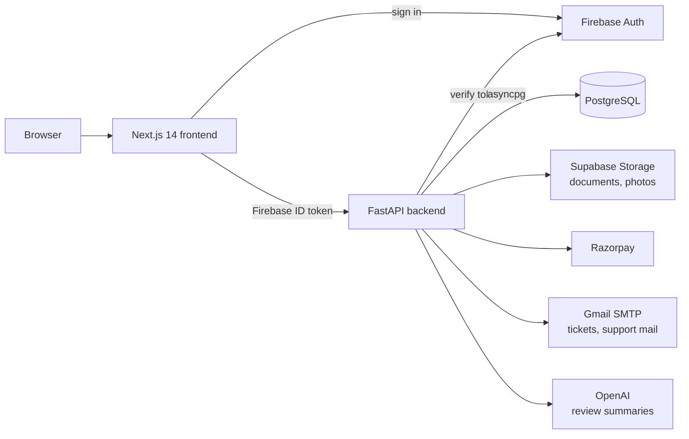

<p align="center">
  <picture>
    <source media="(prefers-color-scheme: dark)" srcset="docs/assets/logo-dark.svg">
    
  </picture>
</p>

<p align="center">
  <strong>Discover shows, pick your seats, pay and get your ticket. All in one flow.</strong>
</p>

<p align="center">
  <a href="https://github.com/VTSLM/Show-Ticket-Booking-System/actions/workflows/ci.yml"></a>
  <a href="https://github.com/VTSLM/Show-Ticket-Booking-System/releases"></a>
  <a href="LICENSE"></a>
  
  
</p>

TicketFlow is a full-stack ticket booking platform for movies, concerts, theatre and other live events. Customers browse shows, lock seats in real time, pay through Razorpay and receive a PDF e-ticket with a QR code by email. Organizers get verified, list venues and shows with flexible seating layouts, and admins review organizers, venues and support requests.

Built by a team of ten for **IT314 Software Engineering** at **DA-IICT** (Batch 2024).

## Contents

- [Features](#features)
- [Architecture](#architecture)
- [Getting started](#getting-started)
- [Running tests](#running-tests)
- [Project structure](#project-structure)
- [Versions and releases](#versions-and-releases)
- [Contributing](#contributing)
- [Team](#team)
- [License](#license)

## Features

**Customers**
- Browse and fuzzy-search shows, filter by type, sort by price or rating, and save shows to a wishlist
- Show details with cast, multiple theatres, formats and showtimes
- Interactive seat maps for cinemas, theatres, concert stages, fan pits and standing zones, with temporary seat locks
- Razorpay checkout (test mode) with retry handling and dynamic seat pricing
- PDF e-tickets with QR codes, emailed on confirmation
- Booking history, cancellation with a 2-hour cutoff and refunds
- Reviews with spoiler flags, helpful votes, threaded comments, critic and audience sections, and AI summaries
- Help centre with FAQs and support requests with conversation threads
- Profile editing with photo upload

**Organizers (managers)**
- Multi-step organizer verification with PAN, GSTIN and IFSC validation and a private document vault
- Venue verification (licence, NOC, capacity, seating plans)
- Show listing with layout templates, premium rows, zones and per-show dynamic pricing
- Review moderation

**Admins**
- Organizer and venue review with mandatory rejection reasons
- Support dashboard with email replies
- Invite-code based admin registration

See the [releases](https://github.com/VTSLM/Show-Ticket-Booking-System/releases) for what shipped in each sprint.

## Architecture



| Layer | Technology |
|-------|------------|
| Frontend | Next.js 14 (App Router), TypeScript, Tailwind CSS, Playwright |
| Backend | FastAPI, Python 3.12, asyncpg, Pydantic 2, pytest |
| Database | PostgreSQL (Supabase today, Azure Database for PostgreSQL planned) |
| Auth | Firebase Authentication |
| Payments | Razorpay (test mode) |
| Tickets | ReportLab, qrcode, Pillow, Gmail SMTP |
| Infrastructure | Docker, Terraform for Azure (planned), GitHub Actions |

## Getting started

### Prerequisites

- Python 3.12
- Node.js 20
- Access to the team's test Supabase, Firebase and Razorpay projects (ask a maintainer), or Docker for a local Postgres

### 1. Configure

```bash
cp backend/.env.example backend/.env
cp frontend/.env.example frontend/.env.local
```

Fill in both files. Put the Firebase service account JSON at `backend/ticketflow-firebase.json` (gitignored) or paste it into `FIREBASE_SERVICE_ACCOUNT_JSON`.

### 2. Database

Using the shared Supabase database, nothing to do. For a local database:

```bash
docker compose --profile localdb up -d db
```

This applies every migration in [`database/migrations`](database/migrations). See [database/README.md](database/README.md).

### 3. Run

```bash
./scripts/dev.sh
```

Or run each side yourself:

```bash
cd backend
python3.12 -m venv .venv && source .venv/bin/activate
pip install -r requirements.txt
uvicorn main:app --reload --port 8000
```

```bash
cd frontend
npm ci
npm run dev
```

Open http://localhost:3000. API docs are at http://localhost:8000/docs.

## Running tests

```bash
cd backend && pytest                 # unit and API tests, no external services needed
cd frontend && npx tsc --noEmit      # type check
cd frontend && npx playwright test   # end-to-end, needs the app running and test accounts in .env.local
```

## Project structure

```text
├── backend/         FastAPI app: routers/, services/, schemas/, models/, tests/
├── frontend/        Next.js app: app/ (routes), components/, contexts/, lib/, tests/ (Playwright)
├── database/        migrations/ (ordered SQL), rollbacks/, seeds/
├── infra/           Terraform for Azure (planned)
├── docs/            requirements/, history/, assets/ (logo)
├── scripts/         dev.sh
├── .github/         CI workflows, issue and PR templates
└── docker-compose.yml
```

## Versions and releases

TicketFlow follows [Semantic Versioning](https://semver.org). Each sprint ends with a tagged release:

| Version | Sprint | Dates |
|---------|--------|-------|
| [v0.1.0](https://github.com/VTSLM/Show-Ticket-Booking-System/releases/tag/v0.1.0) | Sprint 1 | 25 Sep to 6 Nov 2026 |
| [v0.2.0](https://github.com/VTSLM/Show-Ticket-Booking-System/releases/tag/v0.2.0) | Sprint 2 | 7 Nov to 16 Nov 2026 |
| v0.3.0 | Sprint 3 | in progress |
| v1.0.0 | First production deployment on Azure | planned |

To look at the code as it was at the end of a sprint, check out its tag, for example `git checkout v0.1.0`. See [CHANGELOG.md](CHANGELOG.md) for a summary of each version.

## Contributing

All work starts from an issue and lands through a reviewed pull request. Read [CONTRIBUTING.md](CONTRIBUTING.md) before opening your first PR. AI coding tools should read [AGENTS.md](AGENTS.md).

Found a security problem? Follow [SECURITY.md](SECURITY.md) instead of opening a public issue.

## Team

| Member | GitHub | Sprint 1 | Sprint 2 |
|--------|--------|----------|----------|
| Vatsal Mori | [@VTSLM](https://github.com/VTSLM) | Seat allocation, integration, testing | AI review summaries, testing and QA |
| Hari Sharma | [@https-hari](https://github.com/https-hari) | Ticket generation and email, integration | Customer care, cancellation and refunds, debugging |
| Khushi Shah | [@khushishahs02](https://github.com/khushishahs02) | Seat allocation | Organizer verification, show details and venue layouts |
| Kavya | [@Dev-KavyT](https://github.com/Dev-KavyT) | Browse and search | Critics and reviews, browse enhancements |
| Arpit Payasi | [@Arpit-Payasi](https://github.com/Arpit-Payasi) | Browse and search | Critics and reviews |
| Dwij Rikin Patel | [@DwijRikinPatel](https://github.com/DwijRikinPatel) | Authentication | Venue verification, registration security |
| Aditya Rathod | [@AdityaDRathod](https://github.com/AdityaDRathod) | Authentication | Debugging and issue resolution |
| Rishi | [@rishijoshi06](https://github.com/rishijoshi06) | Manager show listing | Testing and QA |
| Darshan Tita | [@darshnn007](https://github.com/darshnn007) | Payment gateway | Cancellation and refunds |
| Tirth Patel | [@mordekeiser](https://github.com/mordekeiser) | Payment gateway | Customer care, dynamic pricing, profile editing |

Who did what in each sprint is tracked on the [project board](https://github.com/VTSLM/Show-Ticket-Booking-System/projects) and in the release notes.

## License

[MIT](LICENSE)
