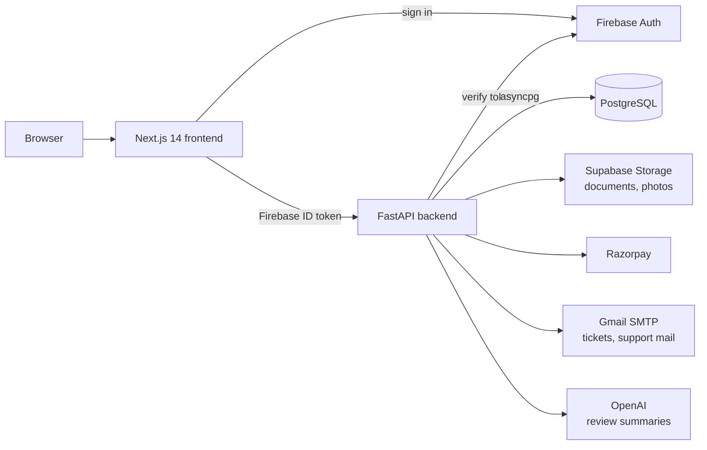

<p align="center">
  <picture>
    <source media="(prefers-color-scheme: dark)" srcset="docs/assets/logo-dark.svg">
    
  </picture>
</p>

<p align="center">
  <strong>Discover shows, pick your seats, pay and get your ticket. All in one flow.</strong>
</p>

<p align="center">
  <a href="https://github.com/VTSLM/Show-Ticket-Booking-System/actions/workflows/ci.yml"></a>
  <a href="https://github.com/VTSLM/Show-Ticket-Booking-System/releases"></a>
  <a href="LICENSE"></a>
  
  
</p>

TicketFlow is a full-stack ticket booking platform for movies, concerts, theatre and other live events. Customers browse shows, lock seats in real time, pay through Razorpay and receive a PDF e-ticket with a QR code by email. Organizers get verified, list venues and shows with flexible seating layouts, and admins review organizers, venues and support requests.

Built by a team of ten for **IT314 Software Engineering** at **DA-IICT** (Batch 2024).

## Contents

- [Features](#features)
- [Architecture](#architecture)
- [Getting started](#getting-started)
- [Running tests](#running-tests)
- [Project structure](#project-structure)
- [Versions and releases](#versions-and-releases)
- [Contributing](#contributing)
- [Team](#team)
- [License](#license)

## Features

**Customers**
- Browse and fuzzy-search shows, filter by type, sort by price or rating, and save shows to a wishlist
- Show details with cast, multiple theatres, formats and showtimes
- Interactive seat maps for cinemas, theatres, concert stages, fan pits and standing zones, with temporary seat locks
- Razorpay checkout (test mode) with retry handling and dynamic seat pricing
- PDF e-tickets with QR codes, emailed on confirmation
- Booking history, cancellation with a 2-hour cutoff and refunds
- Reviews with spoiler flags, helpful votes, threaded comments, critic and audience sections, and AI summaries
- Help centre with FAQs and support requests with conversation threads
- Profile editing with photo upload
- Choose a location and see shows within 100 km with exact distance, all concerts sorted nearest first, Google Maps links and a Recently viewed row
- Join a waitlist for fully booked shows
- Add confirmed bookings to Google Calendar or download an .ics file
- Apply coupon codes at checkout
- In-app and email notifications
- AI chatbot for finding shows and getting support

**Organizers (managers)**
- Multi-step organizer verification with PAN, GSTIN and IFSC validation and a private document vault
- Venue verification (licence, NOC, capacity, seating plans)
- Show listing with layout templates, premium rows, zones and per-show dynamic pricing
- Review moderation
- Venue coordinates set with an interactive map
- Analytics dashboard with revenue, occupancy and customer insights
- One-time QR ticket scanning at venue gates
- Coupon code management

**Admins**
- Organizer and venue review with mandatory rejection reasons
- Support dashboard with email replies
- Invite-code based admin registration

**Platform**
- Request rate limiting (HTTP 429), role-based inactivity logout and security hardening
- Backend deployed on Azure Container Apps with a GitHub Actions CD pipeline

See the [releases](https://github.com/VTSLM/Show-Ticket-Booking-System/releases) for what shipped in each sprint.

## Architecture



| Layer | Technology |
|-------|------------|
| Frontend | Next.js 14 (App Router), TypeScript, Tailwind CSS, Playwright |
| Backend | FastAPI, Python 3.12, asyncpg, Pydantic 2, pytest |
| Database | PostgreSQL (Supabase today, Azure Database for PostgreSQL planned) |
| Auth | Firebase Authentication |
| Payments | Razorpay (test mode) |
| Tickets | ReportLab, qrcode, Pillow, Gmail SMTP |
| Infrastructure | Docker, Azure Container Apps, Vercel, Terraform for Azure (planned), GitHub Actions |

## Getting started

### Prerequisites

- Python 3.12
- Node.js 20
- Access to the team's test Supabase, Firebase and Razorpay projects (ask a maintainer), or Docker for a local Postgres
> **Status:** One app at the repo root. Earlier sprints are tagged: [v0.1.0 (Sprint 1)](https://github.com/VTSLM/Show-Ticket-Booking-System/releases/tag/v0.1.0), [v0.2.0 (Sprint 2)](https://github.com/VTSLM/Show-Ticket-Booking-System/releases/tag/v0.2.0), [v0.3.0 (Sprint 3)](https://github.com/VTSLM/Show-Ticket-Booking-System/releases/tag/v0.3.0).

### 1. Configure

```bash
cp backend/.env.example backend/.env
cp frontend/.env.example frontend/.env.local
```

Fill in both files. Put the Firebase service account JSON at `backend/ticketflow-firebase.json` (gitignored) or paste it into `FIREBASE_SERVICE_ACCOUNT_JSON`.

### 2. Database
## Run Locally

Copy `backend/.env.example` to `backend/.env` and `frontend/.env.example` to `frontend/.env.local`, fill in the team's test values, then run these in two terminals from the repo root (or use `./scripts/dev.sh`).

Using the shared Supabase database, nothing to do. For a local database:

```bash
docker compose --profile localdb up -d db
```

This applies every migration in [`database/migrations`](database/migrations). See [database/README.md](database/README.md).

### 3. Run
**Frontend**

```bash
./scripts/dev.sh
```

Or run each side yourself:
Open [TicketFlow locally](http://localhost:3000). The API docs are at http://localhost:8000/docs.

---

## 🛠️ Tech Stack

| **Layer** | **Technology** |
|-----------|----------------|
| **Frontend** | Next.js 14.2 (App Router, TypeScript, Tailwind CSS) |
| **Backend** | FastAPI (Python 3.9) + asyncpg |
| **Database** | PostgreSQL via Supabase (Session Pooler) |
| **Authentication** | Firebase Authentication (Email / Password) |
| **Payments** | Razorpay Payment Gateway (Test Mode) |
| **Email Delivery** | Gmail SMTP (App Password) |
| **PDF & QR Engine** | ReportLab + qrcode + Pillow |

---

## ✨ Features (Sprint 1)

| **#** | **Feature** | **Branch Name** | **Description** |
|-------|-------------|-----------------|-----------------|
| **F01** | **User Authentication** | `login` | Secure multi-role authentication (User, Manager, Admin) powered by Firebase. |
| **F02** | **Manager Show Listing** | `managers-can-list` | Dashboard for listing, scheduling, and configuring events and venues. |
| **F03** | **Browse & Search Shows** | `browse-nearby-shows` | Interactive event discovery with search and filtering capabilities. |
| **F04** | **Seat Selection & Locking** | `seat-allocation-vatsal` | Interactive seat grid with real-time selection and temporary seat locking. |
| **F05** | **Payment Gateway** | `feature/05-payment-gateway` | Secure payment processing through Razorpay test integration. |
| **F06** | **Ticket Generation & Email** | `ticket-generation-hari` | Automated PDF e-ticket generation with QR codes and email delivery via SMTP. |

> All six features are included in [v0.1.0](https://github.com/VTSLM/Show-Ticket-Booking-System/releases/tag/v0.1.0).

---

## ✨ Features (Sprint 2)

| **#** | **Feature** | **Description** |
|-------|-------------|-----------------|
| **S2-F01** | **Critics & Reviews** | Reviews with critic and audience sections, spoiler flags, helpful votes, comments and AI review summaries. |
| **S2-F02** | **Browse Enhancements** | Fuzzy search, sorting options and separate sections for each type of event. |
| **S2-F03** | **Venue Verification & Admin Review** | Managers submit licence, NOC and capacity details; admins approve or reject with a reason. |
| **S2-F04** | **Registration Security** | Birthdate check, confirm and strong password rules, and a forgot-password fix. |
| **S2-F05** | **Organizer Verification** | PAN, GSTIN and IFSC validation with a private document vault. |
| **S2-F06** | **Show Details & Flexible Venue Layouts** | Cinema, concert, fan pit and stadium layouts with zoom and pan. |
| **S2-F07** | **Customer Care** | Help centre, support requests and admin replies. |
| **S2-F08** | **Ticket Cancellation & Refund** | Cancellation with a 2-hour cutoff and Razorpay refunds. |
| **S2-F09** | **Profile Editing & Dynamic Pricing** | Edit the customer profile, and dynamic seat pricing. |

> All Sprint 2 features are included in [v0.2.0](https://github.com/VTSLM/Show-Ticket-Booking-System/releases/tag/v0.2.0).

---

## ✨ Features (Sprint 3)

| **#** | **Feature** | **Description** |
|-------|-------------|-----------------|
| **S3-F01** | **Location-Based Browsing** | Choose a location, see shows within 100 km with exact distance, all concerts sorted nearest first, a global map, Google Maps links, a Recently viewed row and live search suggestions. |
| **S3-F02** | **Wishlist** | Save movies, concerts and plays, and view them on a My Wishlist page with next showtime and quick book. |
| **S3-F03** | **Add to Calendar** | Add confirmed bookings to Google Calendar or download an .ics file, with a 2-hour reminder. |
| **S3-F04** | **Rate Limiter** | Caps requests per client and returns HTTP 429, blocking brute force, spam and seat-hoarding bots. |
| **S3-F05** | **Waitlist** | Users can join a waitlist for fully booked shows. |
| **S3-F06** | **Ticket Scanning & QR Security** | One-time QR check-in at venue gates for managers and admins, with duplicate scans rejected (HTTP 409). |
| **S3-F07** | **Manager Analytics Dashboard** | Revenue, tickets, occupancy and customer insights with charts, filters and CSV export. |
| **S3-F08** | **AI Chatbot** | Chatbot for finding shows and getting support. |
| **S3-F09** | **Multi-Theatre Booking & Venue Layouts** | Booking across multiple theatres, plus stadium, curved-tier and concert fan-pit layouts. |
| **S3-F10** | **Notifications & Inactivity Logout** | In-app and email notifications with unread count, and role-based automatic logout. |
| **S3-F11** | **Coupon Management** | Managers create coupon codes and customers apply them at checkout for automatic discounts. |
| **S3-F12** | **Security Hardening & Fixes** | Verified logins only, security headers, organisation-level data access and clearer errors. |
| **S3-F13** | **Deployment & CI/CD** | Backend on Azure Container Apps with a GitHub Actions deployment pipeline. |

> All Sprint 3 features are included in [v0.3.0](https://github.com/VTSLM/Show-Ticket-Booking-System/releases/tag/v0.3.0).
>
> 🌐 **Live app:** [https://show-ticket-booking-system.vercel.app/](https://show-ticket-booking-system.vercel.app)

---

```bash
cd backend
python3.12 -m venv .venv && source .venv/bin/activate
pip install -r requirements.txt
uvicorn main:app --reload --port 8000
```

```bash
cd frontend
npm ci
npm run dev
```

Open http://localhost:3000. API docs are at http://localhost:8000/docs.

## Running tests

```bash
cd backend && pytest                 # unit and API tests, no external services needed
cd frontend && npx tsc --noEmit      # type check
cd frontend && npx playwright test   # end-to-end, needs the app running and test accounts in .env.local
```

## Project structure

```text
├── backend/         FastAPI app: routers/, services/, schemas/, models/, tests/
├── frontend/        Next.js app: app/ (routes), components/, contexts/, lib/, tests/ (Playwright)
├── database/        migrations/ (ordered SQL), rollbacks/, seeds/
├── infra/           Terraform for Azure (planned)
├── docs/            requirements/, history/, assets/ (logo)
├── scripts/         dev.sh
├── .github/         CI workflows, issue and PR templates
└── docker-compose.yml
```

## Versions and releases

TicketFlow follows [Semantic Versioning](https://semver.org). Each sprint ends with a tagged release:

| Version | Sprint | Dates |
|---------|--------|-------|
| [v0.1.0](https://github.com/VTSLM/Show-Ticket-Booking-System/releases/tag/v0.1.0) | Sprint 1 | 25 Sep to 6 Nov 2026 |
| [v0.2.0](https://github.com/VTSLM/Show-Ticket-Booking-System/releases/tag/v0.2.0) | Sprint 2 | 7 Nov to 16 Nov 2026 |
| [v0.3.0](https://github.com/VTSLM/Show-Ticket-Booking-System/releases/tag/v0.3.0) | Sprint 3 | 17 Nov to 22 Nov 2026 |
| v1.0.0 | First production deployment on Azure | planned |

To look at the code as it was at the end of a sprint, check out its tag, for example `git checkout v0.1.0`. See [CHANGELOG.md](CHANGELOG.md) for a summary of each version.

## Contributing

All work starts from an issue and lands through a reviewed pull request. Read [CONTRIBUTING.md](CONTRIBUTING.md) before opening your first PR. AI coding tools should read [AGENTS.md](AGENTS.md).

Found a security problem? Follow [SECURITY.md](SECURITY.md) instead of opening a public issue.

## Team
```text
Show-Ticket-Booking-System/
├── backend/        # FastAPI app (routers, services, schemas, tests)
├── frontend/       # Next.js 14 app (App Router, Tailwind, Playwright tests)
├── database/       # Ordered SQL migrations, rollbacks, seeds
├── infra/          # Terraform for Azure (planned)
├── docs/           # Requirements PDFs and historical notes
├── scripts/        # Developer scripts (dev.sh)
├── docker-compose.yml
└── .github/        # CI workflows
```

| Member | GitHub | Sprint 1 | Sprint 2 | Sprint 3 |
|--------|--------|----------|----------|----------|
| Vatsal Mori | [@VTSLM](https://github.com/VTSLM) | Seat allocation, integration, testing | AI review summaries, testing and QA | AI chatbot, deployment and CI/CD, testing |
| Hari Sharma | [@https-hari](https://github.com/https-hari) | Ticket generation and email, integration | Customer care, cancellation and refunds, debugging | AI chatbot, stadium and multi-theatre layouts, security hardening and fixes |
| Khushi Shah | [@khushishahs02](https://github.com/khushishahs02) | Seat allocation | Organizer verification, show details and venue layouts | Notifications, inactivity logout, multi-theatre booking, venue stage layouts |
| Kavya | [@Dev-KavyT](https://github.com/Dev-KavyT) | Browse and search | Critics and reviews, browse enhancements | Location-based browsing, wishlist, rate limiter, add to calendar |
| Arpit Payasi | [@Arpit-Payasi](https://github.com/Arpit-Payasi) | Browse and search | Critics and reviews | Location features, wishlist distance, waitlist |
| Dwij Rikin Patel | [@DwijRikinPatel](https://github.com/DwijRikinPatel) | Authentication | Venue verification, registration security | Coupon management |
| Aditya Rathod | [@AdityaDRathod](https://github.com/AdityaDRathod) | Authentication | Debugging and issue resolution | Debugging and issue resolution |
| Rishi | [@rishijoshi06](https://github.com/rishijoshi06) | Manager show listing | Testing and QA | Ticket scanning and QR security, testing |
| Darshan Tita | [@darshnn007](https://github.com/darshnn007) | Payment gateway | Cancellation and refunds | Backend deployment and CI/CD |
| Tirth Patel | [@mordekeiser](https://github.com/mordekeiser) | Payment gateway | Customer care, dynamic pricing, profile editing | Manager analytics dashboard |

Who did what in each sprint is tracked on the [project board](https://github.com/VTSLM/Show-Ticket-Booking-System/projects) and in the release notes.
> **Database setup:** see [database/README.md](database/README.md).

## License

[MIT](LICENSE)

