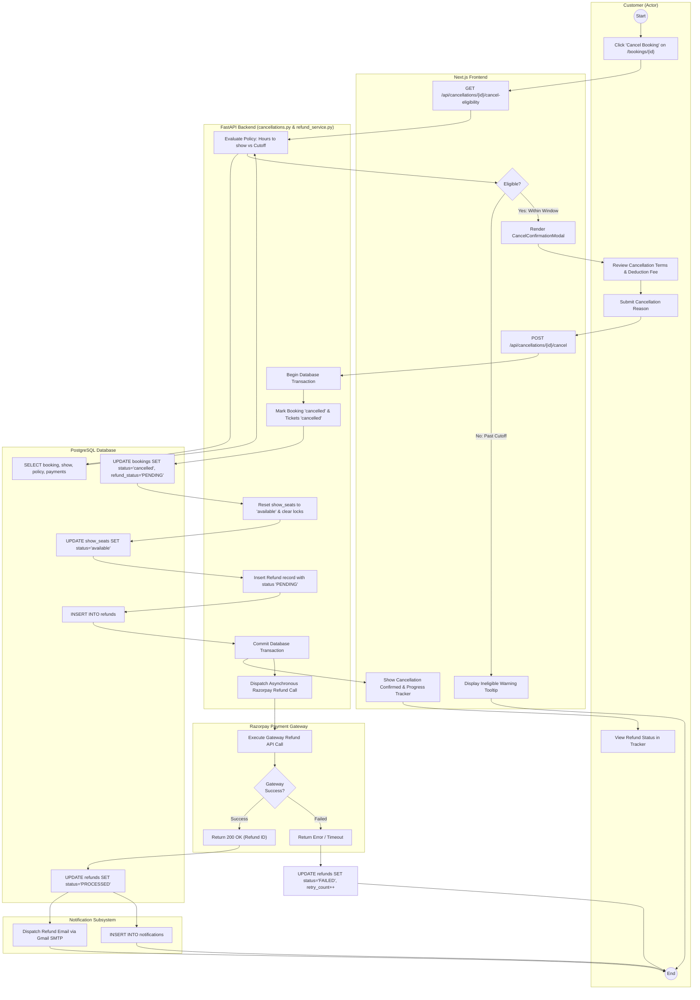

# Activity Diagram: Booking Cancellation and Refund Process

## 1. Description and Purpose
This activity diagram models the end-to-end business and technical workflow for customer booking cancellation, eligibility assessment, deduction fee calculation, transactional seat release, payment gateway refund processing, and notification dispatch.

## 2. Activity Diagram with Swimlanes

## 3. Key Design Observations
- **Asymmetric Coupling:** Seat inventory recovery does not wait for banking settlement. The seats are immediately released within the database transaction (`B_ReleaseSeats`), ensuring venue capacity is promptly restored even if the gateway refund operation requires asynchronous retries.
- **Fail-Safe Administrative Retries:** A failed refund transition (`G_ReturnError`) logs the failure for administrative queue intervention (`/api/cancellations/admin/refunds/{id}/retry`) rather than rolling back the entire seat cancellation.
