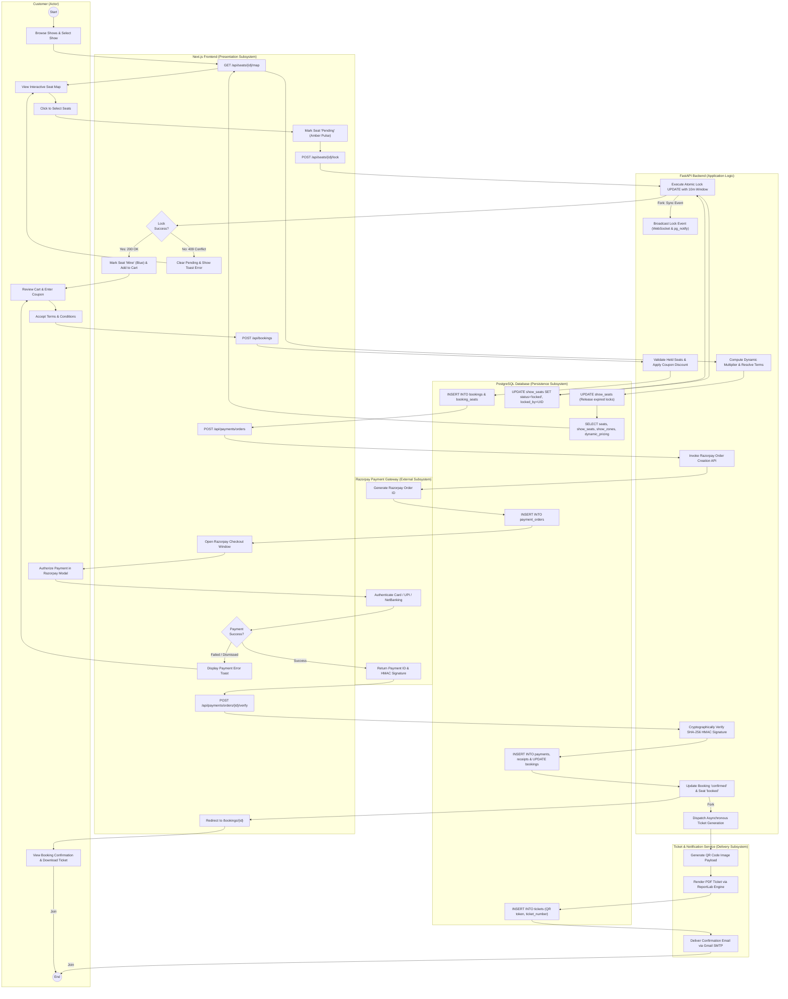

# Activity Diagram: End-to-End Customer Booking Workflow

## 1. Description and Purpose
Following UML 2.0 Activity Diagram principles from Lecture 21 (Activity Diagram, Saurabh Tiwari, DA-IICT), this diagram models the business process workflow of customer seat selection, locking, checkout, payment processing, ticket issuance, and error handling. It utilizes six vertical swimlanes to partition responsibilities across actors and subsystems, clearly distinguishing decision nodes, merge nodes, forks, and joins.

## 2. Activity Diagram with Swimlanes

## 3. Workflow Observations & Lecture Concepts Applied
- **Swimlanes (Partitions):** Six swimlanes clearly assign responsibility for user actions, presentation, application logic, persistence, external financial processing, and notification delivery.
- **Decision vs. Merge:** Distinct decision diamonds are used for lock availability checks and payment authorization outcomes. Merge nodes cleanly recombine alternative paths (e.g., retrying checkout after a failed payment).
- **Fork and Join:** A synchronization fork occurs after booking confirmation: ticket generation and email dispatch proceed concurrently with client UI redirection, joining at workflow termination.
