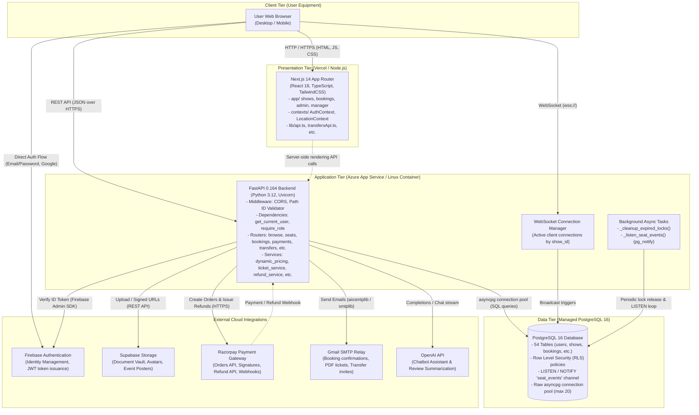

# System Architecture Diagram

## 1. Description and Purpose
This diagram illustrates the high-level system architecture of the TicketFlow platform. TicketFlow is built as a distributed, service-oriented web application employing a four-tier deployment style (Presentation Client, Presentation Server, Application Logic Server, and Relational Database) augmented with third-party cloud services.

## 2. Diagram

## 3. Architectural Interpretation
- **Client & Presentation Separation:** The frontend is decoupled into client-side React components running in the user's browser and Next.js server-rendered pages. Authentication is initiated on the client via Firebase Authentication SDK, while API calls carry Firebase JWT ID tokens to FastAPI.
- **Stateless Application Layer:** FastAPI instances maintain minimal in-memory state (only active WebSocket connections for connected users). All durable state resides in PostgreSQL.
- **Cross-Instance Synchronization:** When seats are locked or released, the instance handling the HTTP request broadcasts to local WebSockets and dispatches a PostgreSQL `pg_notify('seat_events', payload)`. Remote instances pick up the notification via a background listener task, enabling horizontal scalability without requiring Redis.
- **Open Layering:** The API router handlers invoke both business logic services and parameterised asyncpg SQL directly on the pooled database connection, prioritizing low latency and raw query efficiency.

## 4. Implementation References
- `backend/main.py`: Lifespan hooks, router wiring, CORS middleware, background tasks.
- `backend/database.py`: `get_pool()`, `get_conn()`, connection pool configuration.
- `backend/dependencies.py`: `get_current_user()`, `require_role()`.
- `backend/routers/seats.py`: `ConnectionManager`, WebSocket endpoint, pg_notify broadcast.
- `frontend/lib/api.ts`: Centralized fetch client handling bearer tokens and session expiry.
