# Backend Package Diagram

## 1. Description and Purpose
Following the UML Package Diagram guidelines from Lecture 25 (Object Design), this diagram represents the structured organization of backend code, grouping related modules to assist software engineers in program comprehension and change management.

## 2. Package Dependency Diagram

```mermaid
flowchart TD
    subgraph P_Core["backend (Application Root)"]
        Main["main.py\n(FastAPI app, Lifespan, Startup Checks)"]
        Config["config.py\n(App Configuration & Settings)"]
        Database["database.py\n(asyncpg Connection Pool)"]
        Dependencies["dependencies.py\n(get_current_user, require_role)"]
        PathIDs["path_ids.py\n(UUID Validation Middleware)"]
        Firebase["firebase_admin_setup.py\n(Firebase Admin SDK)"]
    end

    subgraph P_Routers["backend/routers (API Controllers)"]
        R_Auth["auth.py, admin_users.py, profile.py"]
        R_Booking["bookings.py, seats.py, payments.py"]
        R_Catalog["browse.py, manager.py, manager_analytics.py"]
        R_Lifecycle["tickets.py, cancellations.py, ticket_transfers.py"]
        R_Feedback["reviews.py, chat.py, notifications.py, support.py"]
        R_Verify["organizer_verification.py, venue_verification.py, verification_admin.py"]
    end

    subgraph P_Services["backend/services (Domain Logic)"]
        S_Pricing["dynamic_pricing.py, terms_service.py"]
        S_Tickets["ticket_service.py, qr_service.py"]
        S_Refunds["refund_service.py, cancellation_policy_service.py, cancellation_notification_service.py"]
        S_Transfers["ticket_transfer.py, transfer_notifier.py, transfer_reimbursement.py, transfer_demo_payments.py"]
        S_Verification["verification.py, document_vault.py, risk_assessment.py, trust_tier_service.py, bank_verification.py"]
        S_Comm["email_service.py, support_email_service.py, chatbot.py, chatbot_tools.py, ai_review_summary_service.py"]
        S_Storage["supabase_storage.py, avatar_storage.py, event_images.py"]
        S_Session["session_service.py"]
    end

    subgraph P_ModelsSchemas["backend/models & schemas (Data Structures)"]
        M_Verify["models/verification.py\n(Risk Assessment & Document Models)"]
        S_Reviews["schemas/reviews.py\n(Review Pydantic Schemas)"]
    end

    %% Internal Dependencies
    Main --> P_Routers
    Main --> Database
    Main --> Config
    Main --> Firebase
    Main --> PathIDs

    P_Routers --> Dependencies
    P_Routers --> Database
    Dependencies --> Firebase
    Dependencies --> Database
    Dependencies --> S_Session

    %% Routers to Services
    R_Auth --> S_Session
    R_Booking --> S_Pricing
    R_Booking --> S_Tickets
    R_Catalog --> S_Storage
    R_Lifecycle --> S_Tickets
    R_Lifecycle --> S_Refunds
    R_Lifecycle --> S_Transfers
    R_Feedback --> S_Comm
    R_Verify --> S_Verification
    R_Verify --> S_Storage

    %% Services to Models
    S_Verification --> M_Verify
    R_Feedback --> S_Reviews

    %% Services to Core
    S_Refunds --> Database
    S_Transfers --> Database
    S_Verification --> Database
    S_Session --> Database
    S_Tickets --> Config
    S_Storage --> Config
```

## 3. Package Responsibility Table
| Package | Primary Responsibility | Major Exports / Classes | Depends On | Used By |
|---|---|---|---|---|
| `backend/routers` | HTTP routing, request parsing, status codes, response formatting | FastAPI router instances (`/api/*`) | `dependencies.py`, `database.py`, `backend/services` | `main.py` |
| `backend/services` | Reusable business logic, validation algorithms, pricing rules | Domain helper functions and workflow coordinators | `database.py`, `config.py`, external SDKs | `backend/routers`, background tasks |
| `backend/models` | Domain models and validation structures for verification cases | `RiskAssessmentResult`, `DocumentMetadata` | Pydantic, Python stdlib | `backend/services/verification.py` |
| `backend/schemas` | Data transfer objects and API request/response validation schemas | `ReviewCreate`, `ReviewResponse`, `CommentCreate` | Pydantic `BaseModel` | `backend/routers/reviews.py` |
| `backend (root)` | App initialization, connection pooling, security dependencies, environment loading | `get_pool()`, `get_conn()`, `get_current_user()`, `validate_path_ids()` | `asyncpg`, `firebase_admin` | All routers and services |

## 4. Architectural Observations
- **Function-Based Modularity:** Python modules in `routers/` and `services/` are structured primarily with async functions rather than object-oriented class hierarchies, aligning with idiomatic FastAPI development.
- **Directional Integrity:** Dependencies flow strictly downward from `routers` $\rightarrow$ `services` $\rightarrow$ `database / config`. There are no circular dependencies between packages.
