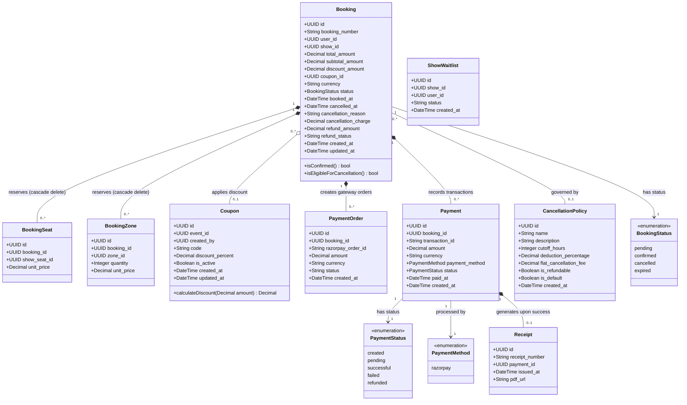

# Class Diagram: Bookings, Payments, and Checkout

## 1. Description and Purpose
This diagram models the core financial and reservation transactions. It represents the lifecycle of a customer reservation from checkout creation through coupon discounts, payment order generation, Razorpay verification, and receipt issuance.

## 2. Class Diagram

## 3. Structural Explanations & Ownership
- **`Booking *-- BookingSeat` & `Booking *-- BookingZone` (Composition `1` to `*`):** A booking seat or zone line item cannot exist without its parent booking (`ON DELETE CASCADE`). If a pending booking is purged, its reserved line items are removed.
- **`Booking o-- Coupon` (Aggregation `*` to `0..1`):** Coupons exist independently of bookings. A booking references an active coupon code to subtract `discount_amount` from `subtotal_amount`.
- **`Booking *-- Payment` (Composition `1` to `*`):** Payments are strictly tied to a single booking entity (`booking_id REFERENCES bookings(id) ON DELETE RESTRICT`). Multiple payment attempts may be created for a single booking if an initial attempt fails.
- **`Payment *-- Receipt` (Composition `1` to `0..1`):** A receipt is issued exactly once for a successful payment (`payment_id UUID NOT NULL UNIQUE REFERENCES payments(id)`).

## 4. Source Traceability
- Tables: `bookings`, `booking_seats`, `booking_zones`, `payment_orders`, `payments`, `receipts`, `coupons`, `show_waitlist`, `cancellation_policies`.
- Migrations: `0001_initial_schema.sql`, `0002_payment_gateway.sql`, `0003_tickets_receipts_and_birthdate.sql`, `0023_cancellation_and_refund_system.sql`, `0025_show_waitlist.sql`, `0027_booking_amounts.sql`, `0029_coupons.sql`.
- Backend Routers: `backend/routers/bookings.py`, `backend/routers/payments.py`.
