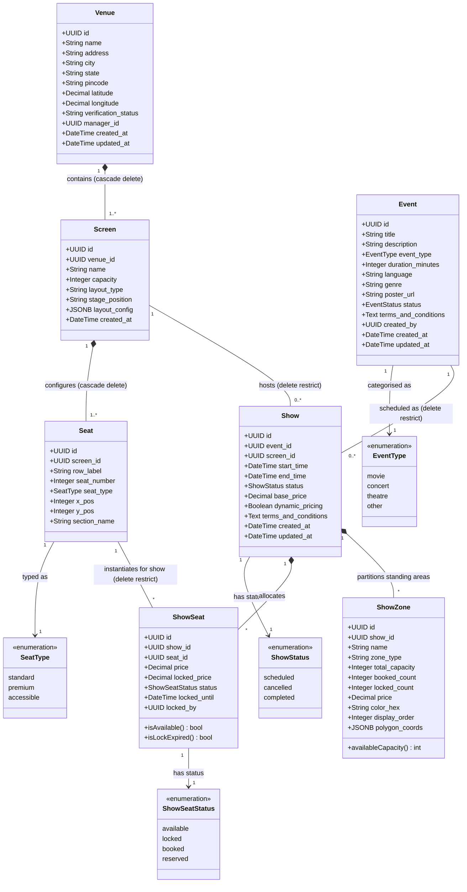

# Class Diagram: Events, Shows, Venues, and Seats

## 1. Description and Purpose
This diagram models the physical and scheduled entities governing venues, screens, events, shows, and seat configurations. It highlights the critical distinction between physical seats (`seats`) tied to a screen, and show-specific seat instances (`show_seats`) that carry dynamic state, price locks, and reservations for a scheduled show.

## 2. Class Diagram

## 3. Relationship Explanations & Multiplicities
- **`Venue *-- Screen` (Composition `1` to `1..*`):** A screen cannot exist outside a venue. Deleting a venue cascades to delete all screens.
- **`Screen *-- Seat` (Composition `1` to `1..*`):** Physical seats are bound to a specific screen layout (`screen_id REFERENCES screens(id) ON DELETE CASCADE`).
- **`Event -- Show` & `Screen -- Show` (Association `1` to `*`):** A show links an event to a screen at a specific time. Foreign keys use `ON DELETE RESTRICT` to preserve historical booking records.
- **`Show *-- ShowSeat` (Composition `1` to `*`):** Each scheduled show generates show-specific seat records that track dynamic price locks and availability (`show_id REFERENCES shows(id) ON DELETE CASCADE`).
- **`Seat -- ShowSeat` (Association `1` to `*`):** Points to the physical seat metadata (`seat_id REFERENCES seats(id) ON DELETE RESTRICT`).

## 4. Source Traceability
- Tables: `venues`, `screens`, `seats`, `events`, `shows`, `show_seats`, `show_zones`.
- Migrations: `0001_initial_schema.sql`, `0012_multi_venue_layouts.sql`, `0018_dynamic_seat_pricing.sql`, `0019_show_details_layout_and_terms.sql`, `0022_align_with_live_schema.sql`.
- Backend Routers: `backend/routers/manager.py`, `backend/routers/browse.py`, `backend/routers/seats.py`.
- Backend Services: `backend/services/dynamic_pricing.py`, `backend/services/terms_service.py`.
