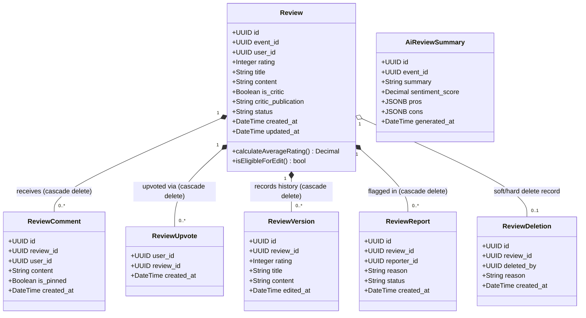

# Class Diagram: Reviews, Ratings, and Feedback

## 1. Description and Purpose
This diagram models the customer and critic review subsystem, including comment threads, upvotes, audit version history, moderation reporting, and automated AI review summarization.

## 2. Class Diagram

## 3. Structural Explanations & Multiplicities
- **`Review *-- ReviewComment` (Composition `1` to `*`):** Comments cannot outlive the parent review.
- **`Review *-- ReviewVersion` (Composition `1` to `*`):** Edits to reviews automatically snapshot the previous state into `review_versions` to ensure accountability and prevent deceptive rating adjustments.
- **`ReviewUpvote` (Link Table):** Has primary key `(user_id, review_id)` ensuring a user can upvote a given review at most once.
- **`AiReviewSummary`:** Associated with an `Event` (`event_id REFERENCES events(id) ON DELETE CASCADE`). Aggregates multiple customer reviews using LLM summarization.

## 4. Source Traceability
- Tables: `reviews`, `review_comments`, `review_upvotes`, `review_versions`, `review_reports`, `review_deletions`, `ai_review_summaries`.
- Migrations: `0010_reviews_module.sql`, `0011_review_deletions.sql`, `0013_critics_and_reviews.sql`, `0017_review_reports.sql`, `0020_ai_review_summaries.sql`.
- Backend Routers: `backend/routers/reviews.py`.
- Backend Services: `backend/services/ai_review_summary_service.py`.
