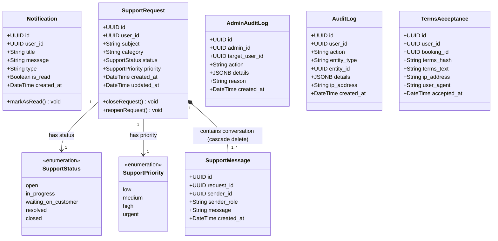

# Class Diagram: Notifications, Support, and System Administration

## 1. Description and Purpose
This diagram models user notifications, support inquiry ticketing, terms & conditions legal compliance tracking, and administrative audit logging across the TicketFlow system.

## 2. Class Diagram

## 3. Structural Explanations & Implementation Constraints
- **Support Request Conversation Hierarchy:** A `SupportRequest` acts as an aggregate container holding ordered `SupportMessage` instances (`request_id REFERENCES support_requests(id) ON DELETE CASCADE`). Messages carry `sender_role` to distinguish customer inquiries from admin responses.
- **Audit Immutability:** Both `AdminAuditLog` and `AuditLog` are append-only. CHECK constraint `admin_audit_log_action_check` validates allowed audit categories: `'role_added'`, `'role_removed'`, `'status_changed'`, `'manager_approved'`, `'manager_rejected'`.
- **Legal Compliance (`TermsAcceptance`):** Records immutable digital acceptance of terms (`terms_hash` SHA-256 fingerprint, user agent, IP address, timestamp) linked to the confirmed booking.

## 4. Source Traceability
- Tables: `notifications`, `support_requests`, `support_messages`, `admin_audit_log`, `audit_log`, `terms_acceptances`.
- Migrations: `0004_customer_care.sql`, `0019_show_details_layout_and_terms.sql`, `0026_admin_audit_log.sql`.
- Backend Routers: `backend/routers/notifications.py`, `backend/routers/support.py`, `backend/routers/support_admin.py`, `backend/routers/admin_users.py`.
- Backend Services: `backend/services/terms_service.py`, `backend/services/support_email_service.py`.
