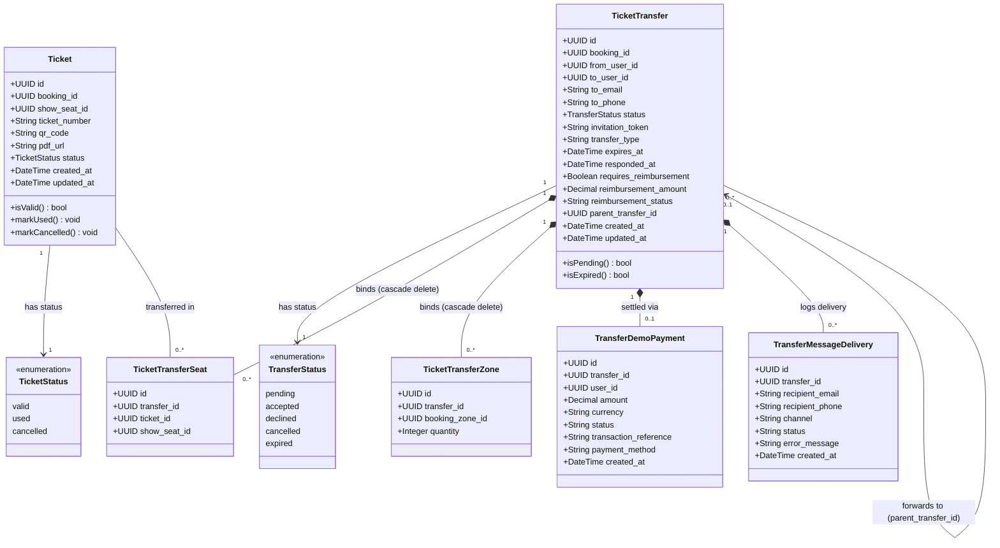

# Class Diagram: Tickets, QR Codes, and Peer-to-Peer Transfers

## 1. Description and Purpose
This diagram models ticket issuance and the peer-to-peer transfer subsystem. TicketFlow supports transferring individual reserved seats or portions of general-admission standing zones by email or phone, complete with optional recipient reimbursement, invitation links, forwarding chains, and verifiable QR codes.

## 2. Class Diagram

## 3. Structural Explanations & Constraints
- **Ticket to Transfer Association:** A ticket exists as a verified entitlement generated upon booking confirmation. During a transfer, `TicketTransferSeat` acts as an association link referencing the transferred `Ticket` (`ON DELETE RESTRICT`) and the `TicketTransfer` (`ON DELETE CASCADE`).
- **Transfer Status Lifecycle:** Enforced by PostgreSQL CHECK constraint `ticket_transfers_status_check`: status must be one of `'pending'`, `'accepted'`, `'declined'`, `'cancelled'`, or `'expired'`.
- **Recipient Identification Flexibility:** Migration `0033` enables transfers to unauthenticated users (`to_user_id` is nullable, but at least one of `to_user_id`, `to_email`, or `to_phone` is mandatory via `ticket_transfers_recipient_required`).
- **Transfer Forwarding (Self-Association):** Migration `0037` allows an accepted transfer to be forwarded to a subsequent recipient via `parent_transfer_id REFERENCES ticket_transfers(id)`, with a constraint preventing direct self-parenting (`parent_transfer_id <> id`).

## 4. Source Traceability
- Tables: `tickets`, `ticket_transfers`, `ticket_transfer_seats`, `ticket_transfer_zones`, `transfer_demo_payments`, `transfer_message_deliveries`.
- Migrations: `0003_tickets_receipts_and_birthdate.sql`, `0031_ticket_transfers.sql` to `0037_transfer_forwarding_and_message_log.sql`.
- Backend Routers: `backend/routers/tickets.py`, `backend/routers/ticket_transfers.py`.
- Backend Services: `backend/services/ticket_service.py`, `backend/services/ticket_transfer.py`, `backend/services/transfer_notifier.py`, `backend/services/transfer_reimbursement.py`.
