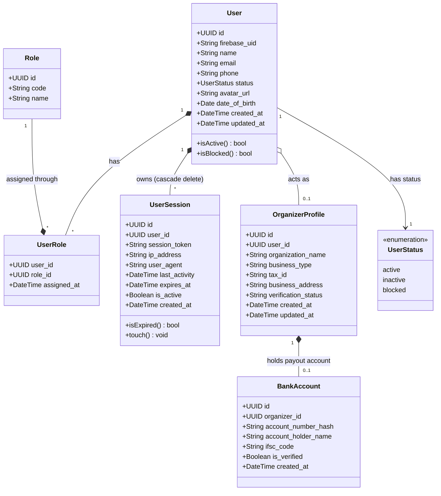

# Class Diagram: Users, Roles, and Identity

## 1. Description and Purpose
This diagram represents the structural model of the Identity and User Management domain. It models persistent database entities derived from `database/schema.sql` (migrations 0001, 0003, 0005, 0024) and their associations.

## 2. Class Diagram

## 3. Relationship Explanations & Implementation Constraints
- **User to Role (Many-to-Many via `UserRole`):** Defined in SQL via the `user_roles` association table (`user_id REFERENCES users(id) ON DELETE CASCADE`, `role_id REFERENCES roles(id) ON DELETE RESTRICT`). Multiplicity is $1 \text{ to } *$.
- **User to UserSession (Composition `1` to `*`):** A user session cannot exist without a user (`user_sessions.user_id REFERENCES users(id) ON DELETE CASCADE`). Its lifetime is bound to the parent user. Inactivity timeout rules apply: Customer (30 min), Organizer (20 min), Admin (15 min).
- **User to OrganizerProfile (Aggregation `1` to `0..1`):** A user may optionally register an organizer profile. The user exists independently of the organizer profile.
- **OrganizerProfile to BankAccount (Composition `1` to `0..1`):** A registered bank account belongs to exactly one organizer profile and is deleted if the profile is removed.

## 4. Source Traceability
- Tables: `users`, `roles`, `user_roles`, `user_sessions`, `organizer_profiles`, `bank_accounts`.
- Backend Routers: `backend/routers/auth.py`, `backend/routers/admin_users.py`, `backend/routers/profile.py`.
- Backend Services: `backend/services/session_service.py`, `backend/services/bank_verification.py`.
- Dependencies: `backend/dependencies.py` (`get_current_user`, `require_role`).
