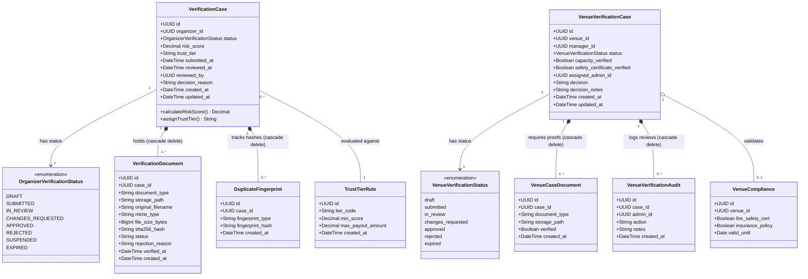

# Class Diagram: Organizer and Venue Verification

## 1. Description and Purpose
This diagram models the trust and safety domain of TicketFlow. As mandated by the platform requirements, Organizer Verification (KYC/AML, risk scoring, document vaulting) is partitioned separately from Venue Verification (physical inspection, fire safety certification, architectural capacity compliance).

## 2. Class Diagram

## 3. Structural Explanations & Implementation Constraints
- **Separation of Concerns:** Organizer verification validates legal business identity (PAN, GSTIN, Company registration, Bank proof), while Venue verification validates physical venue safety, screen counts, and municipal licenses.
- **Composition Constraints (`*--`):** Both `VerificationDocument` and `VenueCaseDocument` share coincident lifetimes with their respective case entities (`ON DELETE CASCADE`). Deletion of a verification case permanently purges document metadata records from the database.
- **Audit Immutability:** `VenueVerificationAudit` entries are append-only; updates and deletes are prevented to guarantee non-repudiation for administrative actions.

## 4. Source Traceability
- Tables: `verification_cases`, `verification_documents`, `duplicate_fingerprints`, `trust_tier_rules`, `venue_verification_cases`, `venue_case_documents`, `venue_compliance`, `venue_verification_audit`.
- Migrations: `0005_organizer_verification.sql`, `0006_venue_verification.sql`, `0007_venue_verification_cases.sql`, `0008_venue_application_fields.sql`.
- Backend Routers: `backend/routers/organizer_verification.py`, `backend/routers/organizer_admin.py`, `backend/routers/venue_verification.py`, `backend/routers/verification_admin.py`.
- Backend Services: `backend/services/verification.py`, `backend/services/document_vault.py`, `backend/services/risk_assessment.py`, `backend/services/trust_tier_service.py`, `backend/services/venue_review.py`.
