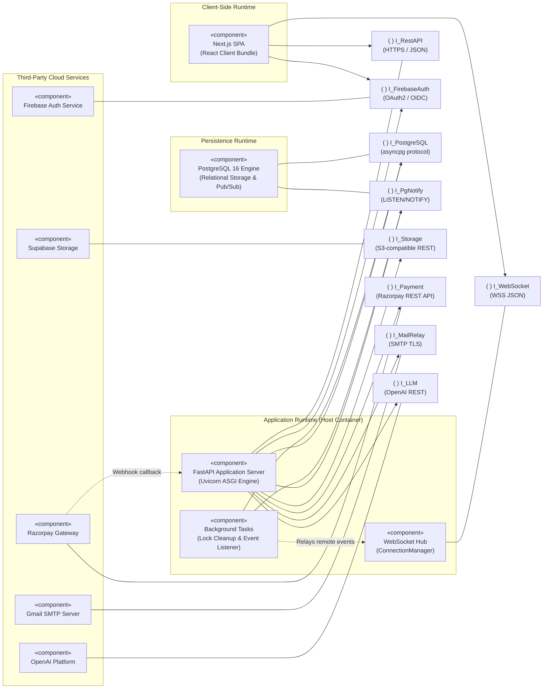
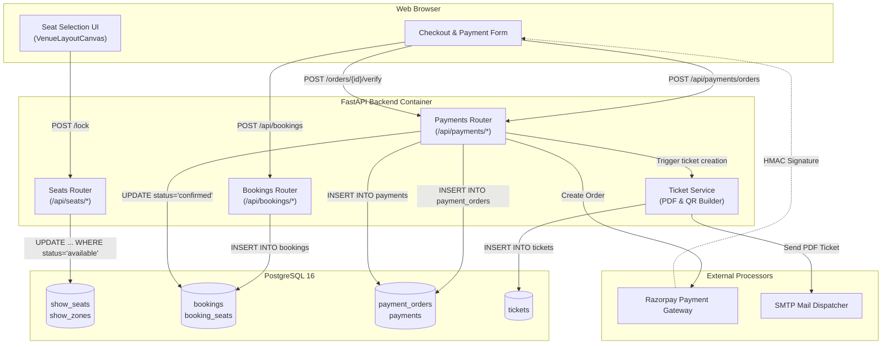

# Component Diagram

## 1. Description and Purpose
Following UML Component Diagram conventions (Lecture 25, Object Design), this diagram depicts how runtime deployable components in TicketFlow are wired together through provided and required interfaces.

## 2. Component Diagram

## 3. Detailed Component View: Booking & Payment Subsystem

## 4. Component Port & Interface Specifications
- **`I_RestAPI`**: RESTful interface providing JSON request/response contracts for show discovery, seat locking, booking, payment, and transfers.
- **`I_WebSocket`**: Bidirectional persistent channel pushing real-time seat lock (`{"type": "lock", "seat_ids": [...]}`) and release events to connected viewers of a show.
- **`I_PgNotify`**: Internal pub/sub connector via PostgreSQL `LISTEN/NOTIFY ('seat_events')` used to coordinate multiple backend container replicas.
