# Frontend Package Diagram

## 1. Description and Purpose
This diagram models the package organization of the Next.js 14 frontend application, showing how route pages, UI components, state contexts, and API client libraries are structured and coupled.

## 2. Package Dependency Diagram

```mermaid
flowchart TD
    subgraph P_App["frontend/app (App Router Pages)"]
        Page_Home["app/page.tsx (Landing / Featured Shows)"]
        Page_Browse["app/browse/page.tsx (Filter, Search, Map View)"]
        Page_Shows["app/shows/[showId]/seats/page.tsx (Interactive Seat Selection)"]
        Page_Bookings["app/bookings/page.tsx, [bookingId]/page.tsx (Checkout & History)"]
        Page_Tickets["app/tickets/page.tsx, received/page.tsx (Wallet & Transfers)"]
        Page_Manager["app/manager/page.tsx, analytics/page.tsx (Organizer Portal)"]
        Page_Admin["app/admin/users, cancellations, transfers, reviews (Admin Console)"]
        Page_Auth["app/auth/login, register, verify-email (Authentication)"]
    end

    subgraph P_Components["frontend/components (Reusable UI Widgets)"]
        C_Layout["Navbar.tsx, AppToaster.tsx, ScrollTabs.tsx"]
        C_Canvas["VenueLayoutCanvas.tsx, arenaLayout.ts (Seat Grid Engine)"]
        C_Modals["CancelConfirmationModal.tsx, TermsAndConditionsModal.tsx, SessionTimeoutModal.tsx"]
        C_Widgets["ChatWidget.tsx, NotificationBell.tsx, AiReviewSummary.tsx, EventPoster.tsx"]
        C_Forms["EventDetailsForm.tsx, TransferTicketsPanel.tsx, ReceivedTicketList.tsx"]
    end

    subgraph P_Contexts["frontend/contexts (State Providers)"]
        Ctx_Auth["AuthContext.tsx\n(Firebase User State, Token Refresh, Inactivity Logout)"]
        Ctx_Location["LocationContext.tsx\n(Selected City, Geolocation Coordinates)"]
    end

    subgraph P_Lib["frontend/lib (API Clients & Utilities)"]
        Lib_Api["api.ts\n(Centralized fetch client, ApiError, Bearer auth)"]
        Lib_Transfers["transfersApi.ts\n(Transfer requests, invitations, claim)"]
        Lib_Cancellations["cancellationsApi.ts\n(Eligibility, cancellation submission)"]
        Lib_Analytics["analyticsApi.ts\n(Event sales, revenue charts)"]
        Lib_Firebase["firebase.ts\n(Firebase Client App & Auth initialization)"]
        Lib_Maps["maps.ts, geo.ts\n(Leaflet / Mapbox utilities, distance calc)"]
        Lib_Errors["errorMessages.ts\n(User-friendly API error sanitization)"]
    end

    %% Page to Component Dependencies
    Page_Shows --> C_Canvas
    Page_Shows --> C_Modals
    Page_Bookings --> C_Modals
    Page_Tickets --> C_Forms
    Page_Manager --> C_Forms
    Page_Home --> C_Widgets
    Page_Browse --> C_Widgets

    %% Context Wrappers
    Page_AppWrapper["app/layout.tsx (Root Layout)"] --> Ctx_Auth
    Page_AppWrapper --> Ctx_Location
    Page_AppWrapper --> C_Layout

    %% Component to Context
    C_Layout --> Ctx_Auth
    C_Layout --> Ctx_Location
    C_Modals --> Ctx_Auth

    %% Pages to Lib
    Page_Shows --> Lib_Api
    Page_Bookings --> Lib_Api
    Page_Tickets --> Lib_Transfers
    Page_Manager --> Lib_Analytics
    Page_Auth --> Lib_Firebase

    %% Lib Dependencies
    Lib_Transfers --> Lib_Api
    Lib_Cancellations --> Lib_Api
    Lib_Analytics --> Lib_Api
    Lib_Api --> Lib_Firebase
    Lib_Api --> Lib_Errors
```

## 3. Package Responsibility Table
| Package Directory | Role | Description |
|---|---|---|
| `frontend/app` | Route Boundaries | Server and Client Pages rendered per URL path |
| `frontend/components` | View Presentation | Reusable UI widgets, modals, canvas elements, and forms |
| `frontend/contexts` | Global State | React Contexts managing global user authentication and active geographic location |
| `frontend/lib` | Domain & Network | Typed REST API clients, Firebase client initialization, math/geometry helpers |

## 4. Key Design Decisions
- **Encapsulated Network Layer:** All network calls route through `lib/api.ts` which automatically attaches Firebase Bearer tokens and handles global session expiration (HTTP 401 with reason `session_expired`).
- **Real-Time Canvas Decoupling:** `VenueLayoutCanvas.tsx` is completely isolated from HTTP fetching; it receives plain seat and zone models as props and emits UI selection events.
