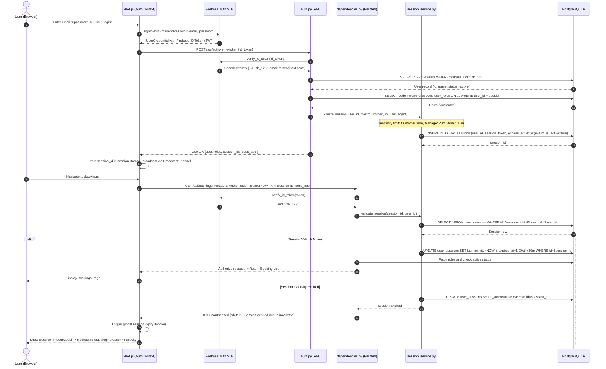

# Sequence Diagram: User Authentication, Session Validation, and Inactivity Tracking

## 1. Description and Purpose
This sequence diagram models user authentication, Firebase token exchange, role resolution, server-side inactivity session management, and automatic role-based session termination.

## 2. Sequence Diagram

## 3. Important Implementation Notes
- **Server-Enforced Inactivity:** Inactivity is enforced authoritatively on the backend within `dependencies.py` and `session_service.py`. A valid Firebase ID token is rejected with HTTP 401 if the corresponding server session record has expired or was revoked.
- **Configurable Role-Based Inactivity Limits:** Customer (30 minutes), Manager/Organizer (20 minutes), and Administrator (15 minutes).
- **Multi-Tab Synchronization:** `BroadcastChannel('ticketflow_session')` synchronizes active sessions across all browser tabs. If a user logs out or times out in one tab, all other tabs immediately transition to the logged-out state.
