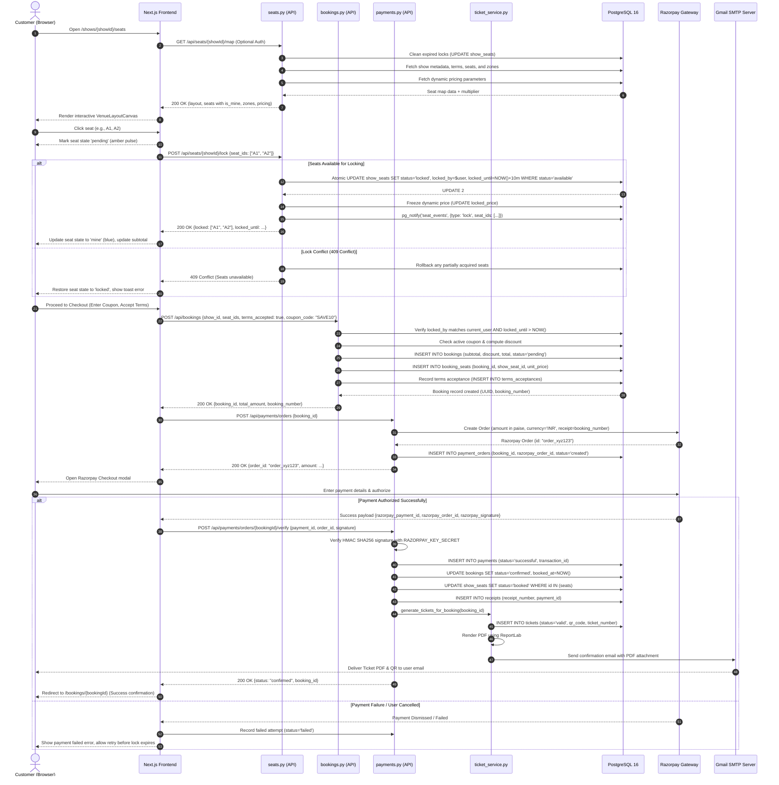

# Sequence Diagram: Customer Seat Selection and Booking Flow

## 1. Description and Purpose
This sequence diagram models the end-to-end customer booking scenario in TicketFlow, tracing the complete interaction across browser, Next.js frontend, FastAPI backend controllers, PostgreSQL database, Razorpay payment gateway, and Gmail SMTP service.

## 2. Sequence Diagram

## 3. Important Implementation Notes
- **Non-Optimistic UI:** As implemented in `frontend/app/shows/[showId]/seats/page.tsx`, the frontend does not add the seat to `selectedSeatIds` until the HTTP 200 response returns from `/api/seats/{showId}/lock`. While pending, an amber pulsating indicator is displayed.
- **Atomic Availability Check:** The backend SQL query simultaneously checks availability and sets `locked_by` in a single atomic statement, preventing race conditions.
- **HMAC Verification:** The signature returned by Razorpay is cryptographically verified on the backend using `hmac.new(key, msg, hashlib.sha256)` before marking the booking as confirmed.
