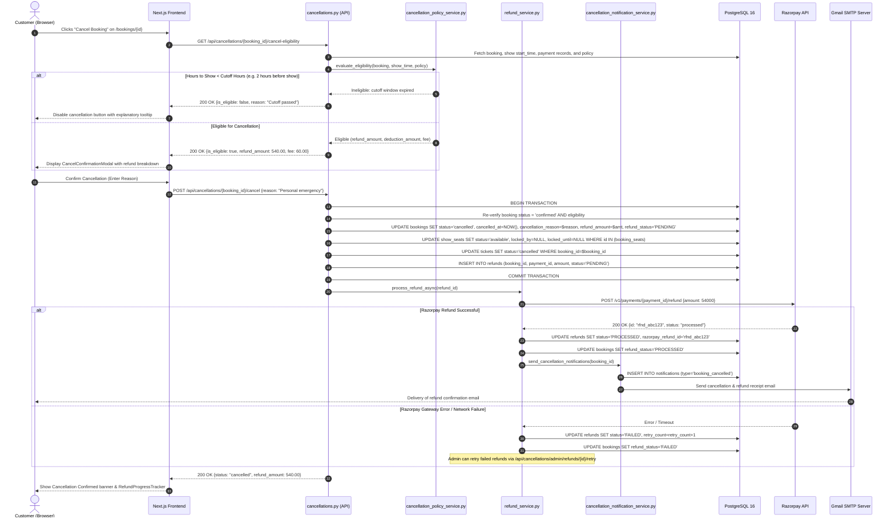

# Sequence Diagram: Booking Cancellation and Refund Flow

## 1. Description and Purpose
This sequence diagram models the booking cancellation and refund process. It details the customer cancellation request, policy cutoff validation, deduction fee calculation, Razorpay refund processing, automatic seat release, and email notification.

## 2. Sequence Diagram

## 3. Important Implementation Notes
- **Transactional Seat Release:** Cancellation marks the booking cancelled and simultaneously resets the associated `show_seats` records back to `available` within a single database transaction, ensuring the seats immediately become available for other customers to reserve.
- **Refund Failure Fault-Tolerance:** If the Razorpay refund API fails (e.g., due to bank gateway downtime), the booking cancellation remains valid and the refund record is marked `FAILED` for administrative retry, preventing customer seats from remaining occupied.
