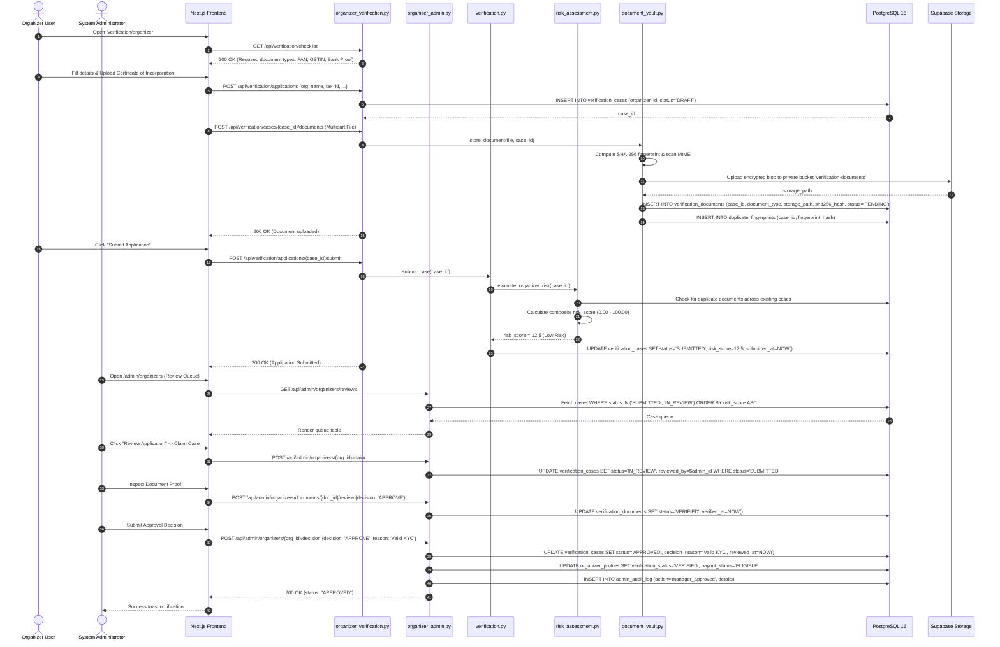

# Sequence Diagram: Organizer Verification Workflow

## 1. Description and Purpose
This sequence diagram models the multi-stage Organizer Verification (KYC/AML) process. It traces the organizer creating a draft application, uploading corporate identity documents into the Supabase document vault, automated risk assessment scoring, administrator review queue claiming, document inspection, and final approval/rejection.

## 2. Sequence Diagram

## 3. Important Implementation Notes
- **Duplicate Detection:** During submission, `duplicate_fingerprints` compares the document SHA-256 hash against previously approved organizers to detect fraudulent identity recycling.
- **Role-Based Case Claiming:** An admin must explicitly claim an application before making a decision, setting status to `IN_REVIEW` and populating `reviewed_by` to avoid conflicting parallel audits by multiple administrators.
