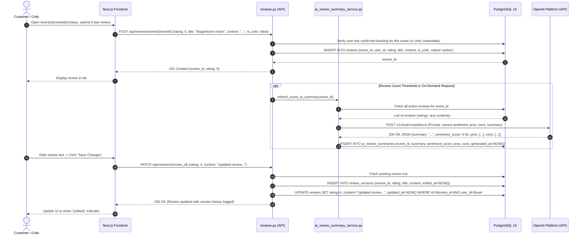

# Sequence Diagram: Review Submission and AI Sentiment Analysis

## 1. Description and Purpose
This sequence diagram models customer and critic review publishing, rating storage, historical version snapshotting upon edits, and automated background AI review summarization using OpenAI.

## 2. Sequence Diagram

## 3. Important Implementation Notes
- **Review Version Auditing:** To prevent deceptive post-hoc edits, every update to an existing review automatically archives a complete snapshot into `review_versions` before modifying the parent row in `reviews`.
- **Verified Purchase / Attendance Check:** Customers can only review events for which they hold a confirmed booking (`reviews.py` enforces booking verification).
