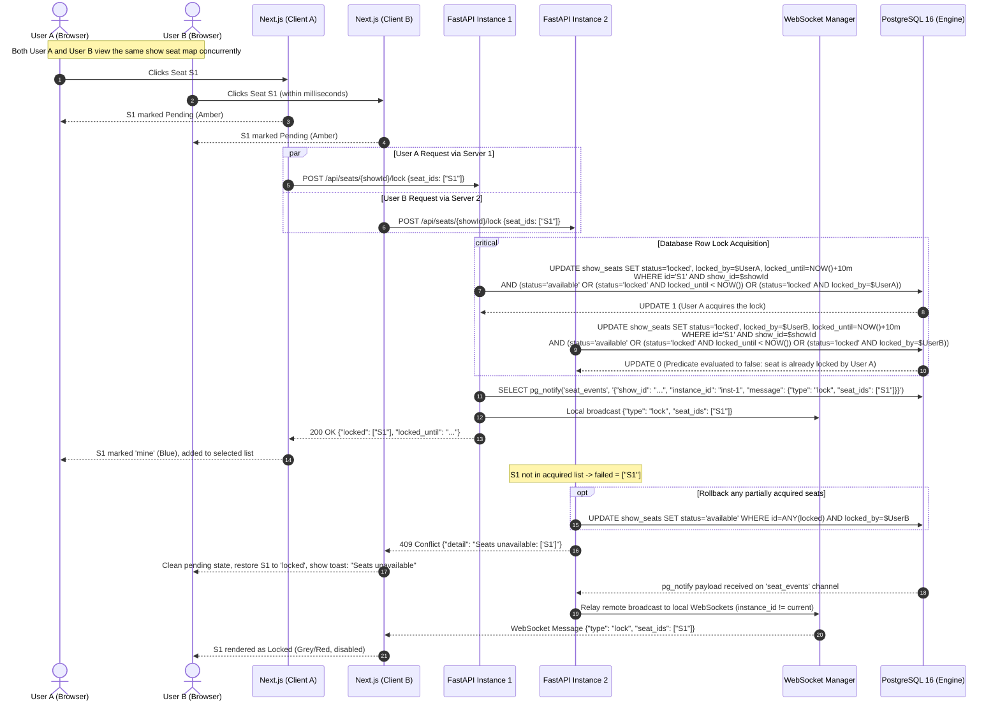

# Sequence Diagram: Seat-Lock Concurrency and Conflict Resolution

## 1. Description and Purpose
This diagram illustrates the race condition scenario where two users (User A and User B) attempt to lock the exact same seat simultaneously. It details how the atomic database query, rollbacks, HTTP 409 status handling, WebSocket broadcasting, and PostgreSQL `pg_notify` cooperate to guarantee consistency across multi-instance backend deployments.

## 2. Sequence Diagram

## 3. Concurrency Protection Mechanisms
- **Single Atomic UPDATE:** TicketFlow uses a single atomic `UPDATE` with a composite `WHERE` clause rather than separate `SELECT FOR UPDATE` followed by `UPDATE`. If the row is already locked by another user, the statement matches zero rows (`UPDATE 0`).
- **Partial Lock Rollback:** If a user requests multiple seats `["S1", "S2"]` and only one succeeds, the failed array triggers an immediate rollback releasing the successfully acquired subset to prevent orphan locks.
- **Cross-Instance Notification (`pg_notify`):** When Instance 1 handles User A's lock, Instance 2 receives the notification via PostgreSQL LISTEN and pushes the update to User B's open WebSocket connection without polling.
