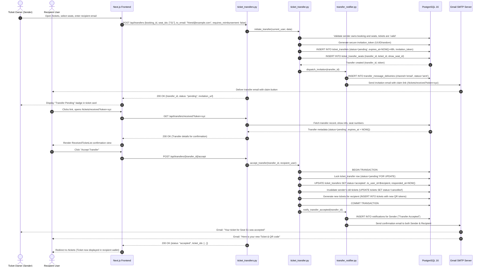

# Sequence Diagram: Ticket Transfer Flow

## 1. Description and Purpose
This sequence diagram models the peer-to-peer ticket transfer workflow implemented across migrations 0031–0037, `ticket_transfers.py`, and `ticket_transfer.py`. It details the sender initiating a transfer for specific seats or standing zones, recipient invitation via email/token, optional reimbursement via demo checkout, acceptance, and ticket reissuance.

## 2. Sequence Diagram

## 3. Important Implementation Notes
- **Ticket Revocation & Reissuance:** When a transfer is accepted, the original ticket QR code is permanently invalidated (`status = 'cancelled'`) and a fresh ticket with a new unique QR payload is generated for the recipient. This prevents the original owner from using a printed or screenshotted copy at the gate.
- **Expiration Task:** Background reconciliation runs periodically via `expire_pending_transfers(conn)` in `backend/main.py` to expire unaccepted transfers past their `expires_at` deadline and release the transfer lock.
