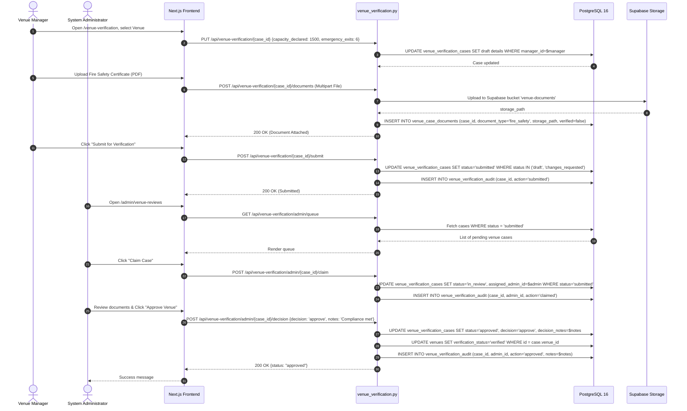

# Sequence Diagram: Venue Verification Flow

## 1. Description and Purpose
This sequence diagram models the Venue Verification process (`backend/routers/venue_verification.py`), which validates physical venue premises, structural capacity declarations, municipal permissions, and safety certifications before shows can be published.

## 2. Sequence Diagram

## 3. Important Implementation Notes
- **Independent Case Lifecycle:** Venue verification is governed independently from organizer verification. An organizer with an approved KYC may still have an unverified venue until physical safety inspections and license certificates are cleared.
- **Audit Non-Repudiation:** Every action (`submitted`, `claimed`, `approved`, `rejected`, `changes_requested`) appends an immutable entry to `venue_verification_audit`.
