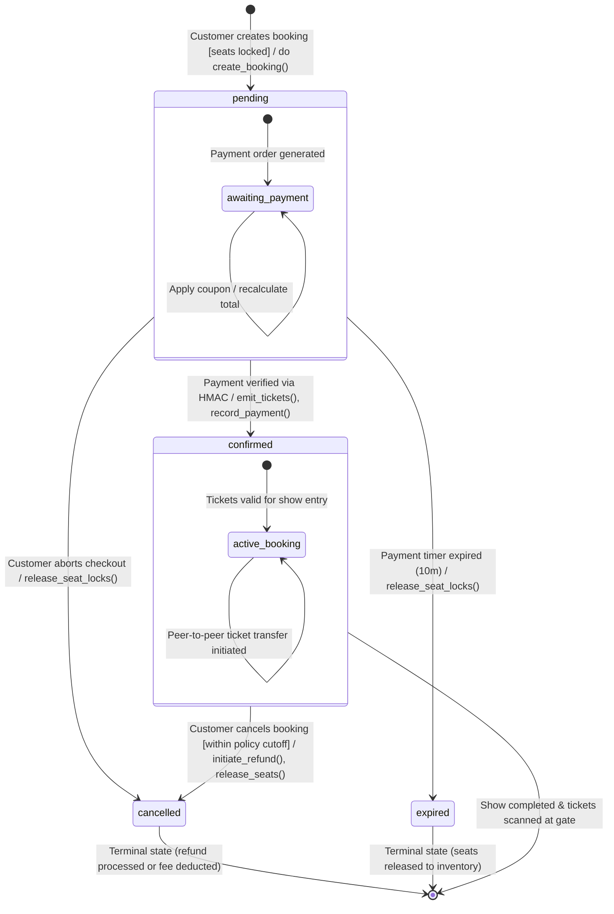

# State Machine Diagram: Booking Lifecycle

## 1. Description and Purpose
Following UML State Machine conventions (Lecture 23, UML State Diagram), this diagram models the lifecycle of a `Booking` entity. States, triggers, guard conditions, and actions are derived strictly from the PostgreSQL `booking_status` enum, CHECK constraints, and backend logic in `backend/routers/bookings.py`, `backend/routers/payments.py`, and `backend/routers/cancellations.py`.

## 2. State Machine Diagram

## 3. State Definitions and Transition Table
| Source State | Event / Trigger | Guard Condition | Target State | Actions / Effects |
|---|---|---|---|---|
| `[*]` | Checkout initiated | Seats locked by current user | `pending` | `INSERT INTO bookings (status='pending')`, record line items |
| `pending` | Payment verified | Valid HMAC signature from Razorpay | `confirmed` | `UPDATE bookings SET status='confirmed'`, generate tickets, send email |
| `pending` | Timer expiry | `locked_until < NOW()` | `expired` | `UPDATE bookings SET status='expired'`, release held seats |
| `pending` | User cancellation | Explicit cancel before payment | `cancelled` | Reset held seat locks to `available` |
| `confirmed` | Cancellation requested | Show time $-$ NOW() $\ge$ policy cutoff hours | `cancelled` | Record refund, reset show seats to `available`, cancel tickets |
| `confirmed` | Event date passed | Show completed | `[*]` | Mark booking fulfilled |

## 4. Source Traceability
- Enum: `booking_status ('pending', 'confirmed', 'cancelled', 'expired')` in `database/migrations/0001_initial_schema.sql`.
- Code: `backend/routers/bookings.py`, `backend/routers/payments.py`, `backend/routers/cancellations.py`.
