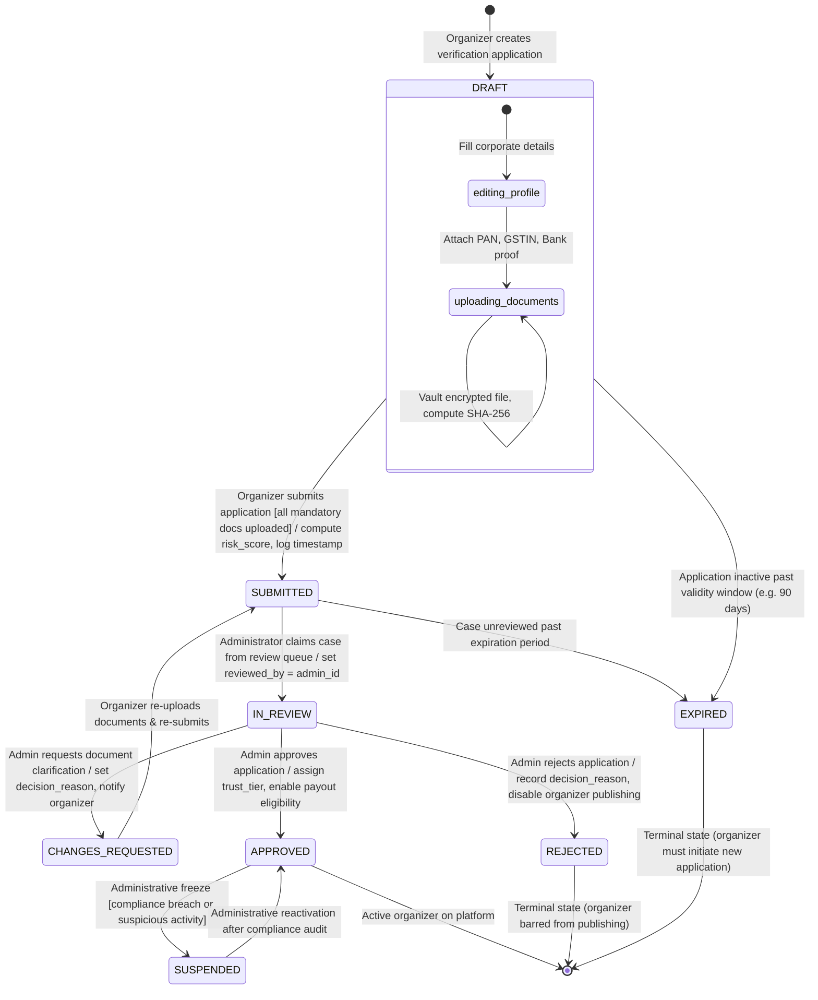

# State Machine Diagram: Organizer Verification Lifecycle

## 1. Description and Purpose
This diagram models the lifecycle of organizer KYC/AML verification applications (`verification_cases`). Allowed states reflect database migration 0005: `DRAFT`, `SUBMITTED`, `IN_REVIEW`, `CHANGES_REQUESTED`, `APPROVED`, `REJECTED`, `SUSPENDED`, and `EXPIRED`.

## 2. State Machine Diagram

## 3. Transition Rules and Constraints
- **Invariants:** Governed by `verification_cases.status`. Transition to `APPROVED` automatically updates `organizer_profiles.verification_status = 'VERIFIED'` and `payout_status = 'ELIGIBLE'`.
- **Changes Requested Loop:** Enables organizers to resolve blurred or expired documents without forfeiting their application history.
- **Audit Logging:** Every transition from `IN_REVIEW` appends an entry to `admin_audit_log`.
