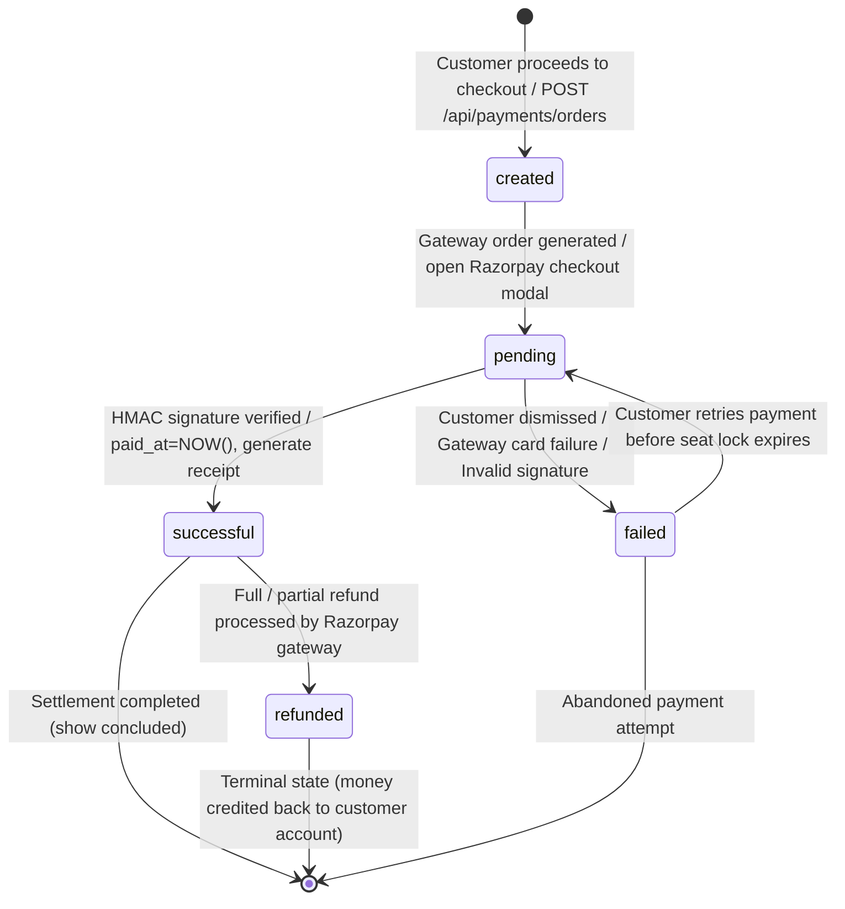

# State Machine Diagram: Payment Lifecycle

## 1. Description and Purpose
This diagram models the financial transaction state lifecycle of a `Payment` entity. States reflect the PostgreSQL `payment_status` enum (`created`, `pending`, `successful`, `failed`, `refunded`) and interaction with the Razorpay payment gateway.

## 2. State Machine Diagram

## 3. Transition Rules and Constraints
- **`created` to `pending`:** Triggered when the backend creates an order via Razorpay API (`razorpay_order_id`).
- **`pending` to `successful`:** Triggered when the customer completes payment in the modal and the backend cryptographically verifies the SHA-256 signature (`payments.paid_at = NOW()`).
- **`successful` to `refunded`:** Triggered when a cancellation is approved and Razorpay processes the refund.
- Enums: `payment_status ('created', 'pending', 'successful', 'failed', 'refunded')` in `database/migrations/0001_initial_schema.sql`.
