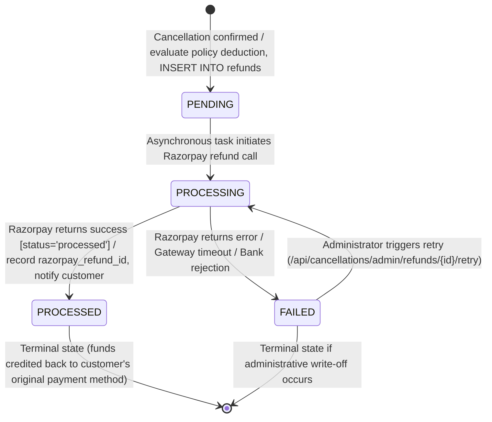

# State Machine Diagram: Refund Lifecycle

## 1. Description and Purpose
This diagram models the lifecycle of financial refunds (`refunds`) resulting from cancelled bookings. States and transitions reflect `refund_status` values (`PENDING`, `PROCESSING`, `PROCESSED`, `FAILED`) and administrative retry logic.

## 2. State Machine Diagram

## 3. Transition Rules and Constraints
- **Separation from Booking Status:** A booking transitions to `cancelled` immediately upon customer request, freeing seats for other patrons. The `Refund` entity manages the asynchronous banking reconciliation lifecycle independently.
- **Retry Mechanism:** When in state `FAILED`, an administrator can invoke `/api/cancellations/admin/refunds/{id}/retry` which transitions the refund back to `PROCESSING` and increments `retry_count`.
- Database constraint: `status IN ('PENDING', 'PROCESSING', 'PROCESSED', 'FAILED')` in `0009_cancellation_refund.sql` and `0023_cancellation_and_refund_system.sql`.
