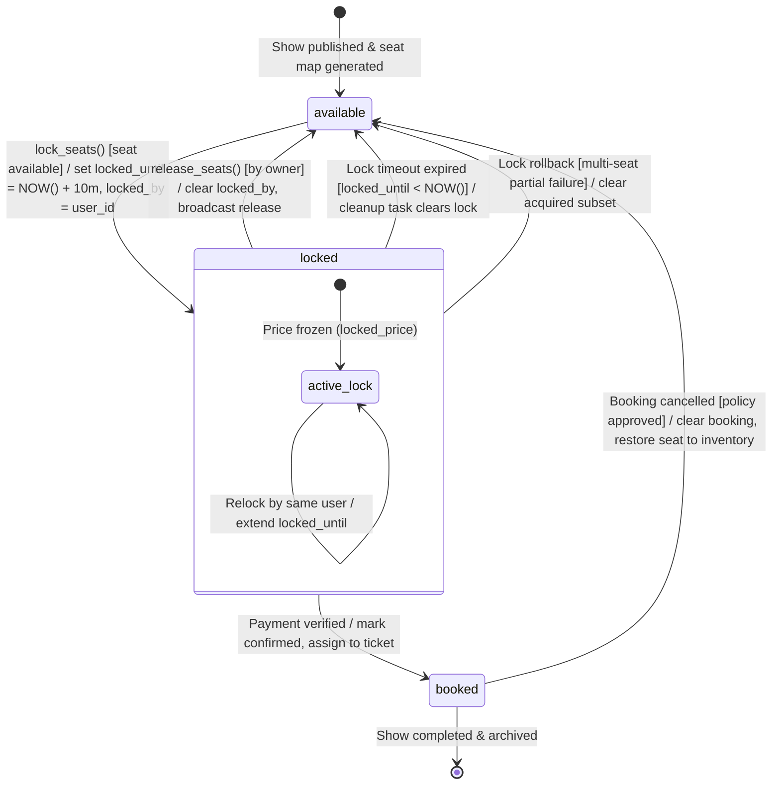

# State Machine Diagram: Show Seat Lifecycle

## 1. Description and Purpose
This diagram models the lifecycle of individual show seat instances (`show_seats`). States, guards, and transitions reflect the PostgreSQL `show_seat_status` enum (`available`, `locked`, `booked`, `reserved`) and the atomic locking, release, expiration, and booking logic.

## 2. State Machine Diagram

## 3. State Definitions and Transition Rules
| State | Invariants / Database Attributes | Meaning |
|---|---|---|
| `available` | `status = 'available'`, `locked_until IS NULL`, `locked_by IS NULL` | Open for customer selection and reservation. |
| `locked` | `status = 'locked'`, `locked_until > NOW()`, `locked_by IS NOT NULL` | Temporarily held by a user during checkout (10 minutes window). |
| `booked` | `status = 'booked'`, permanent booking confirmed | Paid and assigned to a ticket. Cannot be selected or locked. |
| `reserved` | `status = 'reserved'` | Administrative hold (e.g., VIP, venue crew, or accessibility block). |

## 4. Source Traceability
- Enum: `show_seat_status ('available', 'locked', 'booked', 'reserved')` in `0001_initial_schema.sql`.
- Invariant constraint: `CHECK ((status = 'locked' AND locked_until IS NOT NULL AND locked_by IS NOT NULL) OR status <> 'locked')`.
- Code: `backend/routers/seats.py`, `backend/routers/payments.py`, `backend/routers/cancellations.py`, `backend/main.py` (`_cleanup_expired_locks`).
