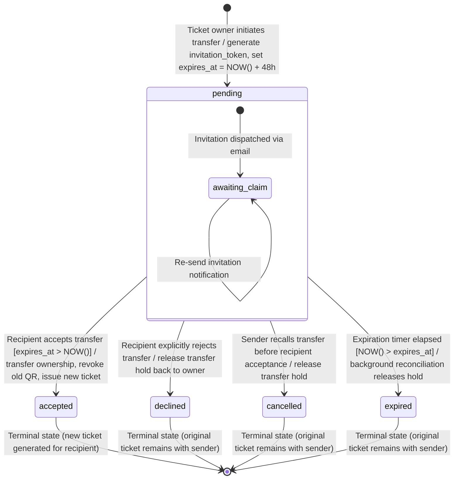

# State Machine Diagram: Ticket Transfer Lifecycle

## 1. Description and Purpose
This diagram models the lifecycle of peer-to-peer ticket transfers (`ticket_transfers`). As enforced by migration 0032 (`ticket_transfers_status_check`), valid statuses are `'pending'`, `'accepted'`, `'declined'`, `'cancelled'`, and `'expired'`.

## 2. State Machine Diagram

## 3. Transition Rules and Constraints
- **CHECK Constraint:** `status IN ('pending', 'accepted', 'declined', 'cancelled', 'expired')` in `database/migrations/0032_ticket_transfer_expiry.sql`.
- **Atomic Acceptance:** On acceptance, a database transaction validates that the transfer is still `pending` and not expired (`FOR UPDATE`), revokes the sender's ticket (`UPDATE tickets SET status='cancelled'`), and creates the recipient's ticket.
- **Reimbursement Guard:** If `requires_reimbursement = true`, acceptance transitions through demo payment settlement (`reimbursement_status = 'completed'`) before tickets are transferred.
