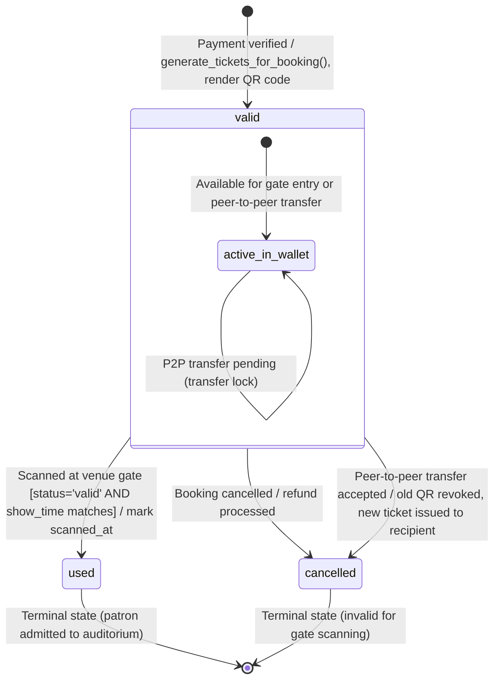

# State Machine Diagram: Ticket Lifecycle

## 1. Description and Purpose
This diagram models the lifecycle of individual admission tickets (`tickets`). The valid states and constraints are governed by PostgreSQL CHECK constraints and gate scanning operations in `backend/routers/tickets.py`.

## 2. State Machine Diagram

## 3. Transition Rules and Constraints
- **`valid` State:** The ticket possesses an active, cryptographically signed QR payload.
- **`used` State:** Triggered by `/api/tickets/scan` or `/api/tickets/bookings/{id}/scan`. Scanning a ticket already marked `used` raises HTTP 400 (`Ticket has already been scanned`).
- **`cancelled` State:** Irrevocable invalidation. Occurs either upon booking cancellation or when a ticket transfer is accepted by a recipient (the sender's original ticket is cancelled and replaced by a newly minted ticket with a fresh QR token).
- Database constraint: `status IN ('valid', 'used', 'cancelled')` in `0003_tickets_receipts_and_birthdate.sql`.
