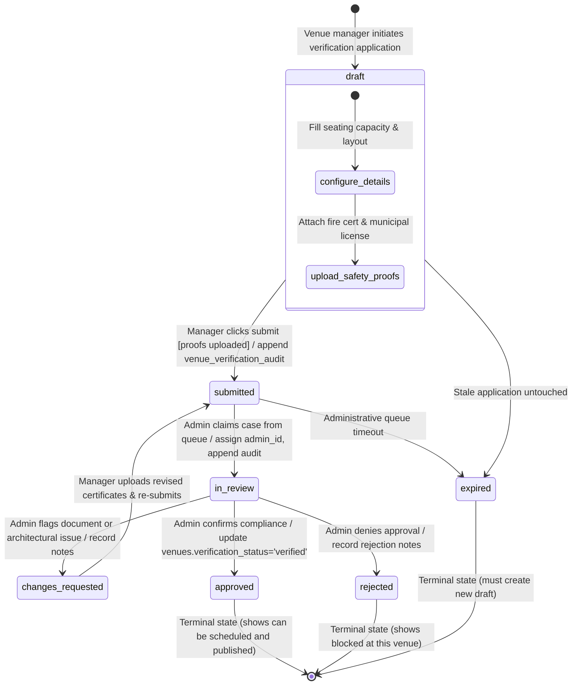

# State Machine Diagram: Venue Verification Lifecycle

## 1. Description and Purpose
This diagram models the verification lifecycle of physical event spaces and auditoriums (`venue_verification_cases`). Allowed statuses derive from migrations 0006 and 0007: `draft`, `submitted`, `in_review`, `changes_requested`, `approved`, `rejected`, and `expired`.

## 2. State Machine Diagram

## 3. Transition Rules and Constraints
- **Separation:** Independent from the organizer's legal verification. A verified organizer cannot publish shows at an unverified venue.
- **Audit Requirement:** The `venue_verification_audit` table enforces strict event recording for every status transition.
- **Database Column:** Status is lowercase text with check constraint `CHECK (status IN ('draft', 'submitted', 'in_review', 'approved', 'rejected', 'changes_requested', 'expired'))`.
