# Subsystem Decomposition

## 1. Description and Purpose
Following the subsystem decomposition principles taught in IT314 (Saurabh Tiwari, Lecture 24), a system is partitioned into subsystems to achieve high cohesion within boundaries and low coupling across boundaries. This document defines the 14 logical subsystems of TicketFlow, distinguishing vertical layers from horizontal functional partitions.

## 2. Subsystem Decomposition Diagram

```mermaid
flowchart TB
    subgraph PresentationLayer["Presentation Layer (Client & Frontend Subsystems)"]
        UI_Customer["Customer Portal\n(Browse, Seat Selection, Checkout, History, Profile)"]
        UI_Manager["Organizer / Manager Portal\n(Venues, Events, Shows, Analytics, Coupons)"]
        UI_Admin["Administration Console\n(User Management, Verifications, Refunds, Audits)"]
    end

    subgraph ServiceLayer["Application Logic Layer (FastAPI Routers & Services)"]
        subgraph CoreSubsystems["Core Business Partitions"]
            SS_Identity["1. Identity & Session Management\n(auth.py, admin_users.py, session_service.py)"]
            SS_Browse["2. Event Discovery & Browsing\n(browse.py, geo_service.py, wishlist.py)"]
            SS_Catalog["3. Event, Venue & Show Mgmt\n(manager.py, event_images.py)"]
            SS_Seats["4. Seat Layout & Reservation\n(seats.py, dynamic_pricing.py, terms_service.py)"]
            SS_Booking["5. Booking Management\n(bookings.py, waitlist, coupons)"]
            SS_Payment["6. Payment & Financial\n(payments.py, Razorpay SDK)"]
            SS_Ticket["7. Ticket Generation & Validation\n(tickets.py, ticket_service.py, qr_service.py)"]
        end

        subgraph LifecycleSubsystems["Post-Booking & Secondary Partitions"]
            SS_Cancel["8. Cancellation & Refunds\n(cancellations.py, refund_service.py, policies)"]
            SS_Transfer["9. Ticket Transfer Management\n(ticket_transfers.py, transfer_notifier.py)"]
            SS_Review["10. Review & Feedback\n(reviews.py, ai_review_summary_service.py)"]
        end

        subgraph TrustSubsystems["Trust, Governance & Support Partitions"]
            SS_OrgVerify["11. Organizer Verification\n(organizer_verification.py, risk_assessment.py)"]
            SS_VenueVerify["12. Venue Verification\n(venue_verification.py, venue_review.py)"]
            SS_Notify["13. Notifications & AI Assistant\n(notifications.py, email_service.py, chat.py)"]
            SS_Support["14. Support & Administration\n(support.py, support_admin.py, audit_log)"]
        end
    end

    subgraph PersistenceLayer["Data Access & Persistence Layer"]
        DB[("PostgreSQL 16 Database Pool\n(Raw asyncpg, Transactions, RLS)")]
        Storage[("Supabase Storage Buckets\n(documents, avatars, posters)")]
    end

    %% Presentation to Services
    UI_Customer --> SS_Browse
    UI_Customer --> SS_Seats
    UI_Customer --> SS_Booking
    UI_Customer --> SS_Payment
    UI_Customer --> SS_Ticket
    UI_Customer --> SS_Cancel
    UI_Customer --> SS_Transfer
    UI_Customer --> SS_Review

    UI_Manager --> SS_Catalog
    UI_Manager --> SS_Seats

    UI_Admin --> SS_Identity
    UI_Admin --> SS_OrgVerify
    UI_Admin --> SS_VenueVerify
    UI_Admin --> SS_Cancel
    UI_Admin --> SS_Support

    %% Cross-Subsystem Service Invocations
    SS_Booking -->|"Validates held seats"| SS_Seats
    SS_Booking -->|"Checks active coupon"| SS_Catalog
    SS_Payment -->|"Updates status to confirmed"| SS_Booking
    SS_Payment -->|"Creates verified ticket records"| SS_Ticket
    SS_Cancel -->|"Releases booked seats to available"| SS_Seats
    SS_Cancel -->|"Initiates gateway refund"| SS_Payment
    SS_Transfer -->|"Validates and updates ticket owner"| SS_Ticket
    SS_OrgVerify -->|"Vaults encrypted docs"| Storage

    %% Services to Persistence
    CoreSubsystems --> DB
    LifecycleSubsystems --> DB
    TrustSubsystems --> DB
```

## 3. Subsystem Breakdown Table
| # | Subsystem Name | Primary Responsibility | Key Modules / Files | Provided Interfaces (APIs) | Dependencies |
|---|---|---|---|---|---|
| 1 | Identity & Session Mgmt | Registration, token exchange, session inactivity tracking, role check | `auth.py`, `admin_users.py`, `session_service.py` | `/api/auth/*`, `/api/admin/users/*` | Firebase Auth, `users`, `user_sessions` |
| 2 | Event Discovery & Browsing | Catalog browsing, geolocation search, distance calculation, wishlist | `browse.py`, `geo_service.py`, `wishlist.py` | `/api/browse/*`, `/api/wishlist/*` | `events`, `shows`, `venues`, `wishlists` |
| 3 | Event, Venue & Show Mgmt | Organizer dashboard for event creation, screen setup, show scheduling | `manager.py`, `event_images.py` | `/api/manager/*` | Supabase Storage, `events`, `screens`, `shows` |
| 4 | Seat Layout & Reservation | Seat grid generation, concurrency-safe locking, pricing multipliers | `seats.py`, `dynamic_pricing.py` | `/api/seats/*`, `/api/seats/{id}/ws` | `show_seats`, `show_zones`, Postgres NOTIFY |
| 5 | Booking Management | Checkout cart, booking number generation, coupon validation, waitlist | `bookings.py`, `terms_service.py` | `/api/bookings/*` | `bookings`, `booking_seats`, `coupons` |
| 6 | Payment & Financial | Razorpay order creation, HMAC signature verification, receipts | `payments.py` | `/api/payments/*` | Razorpay Gateway, `payments`, `payment_orders` |
| 7 | Ticket Generation & Validation | PDF ticket rendering with ReportLab, QR generation, gate scanning | `tickets.py`, `ticket_service.py`, `qr_service.py` | `/api/tickets/*` | `tickets`, ReportLab, qrcode |
| 8 | Cancellation & Refunds | Cancellation eligibility evaluation, deduction logic, Razorpay refund | `cancellations.py`, `refund_service.py` | `/api/cancellations/*` | `refunds`, `cancellation_policies`, Razorpay |
| 9 | Ticket Transfer Management | P2P ticket transfers, recipient claims, ticket splitting, demo payments | `ticket_transfers.py`, `ticket_transfer.py` | `/api/transfers/*` | `ticket_transfers`, `transfer_demo_payments` |
| 10 | Review & Feedback | User ratings, critic reviews, version history, AI sentiment summaries | `reviews.py`, `ai_review_summary_service.py` | `/api/reviews/*` | `reviews`, `review_versions`, OpenAI |
| 11 | Organizer Verification | KYC verification case processing, risk scoring, document vaulting | `organizer_verification.py`, `verification.py` | `/api/verification/*` | `verification_cases`, Supabase Vault |
| 12 | Venue Verification | Physical venue compliance inspection, proof review, approval workflow | `venue_verification.py`, `venue_review.py` | `/api/venue-verification/*` | `venue_verification_cases`, `venues` |
| 13 | Notifications & AI Assistant | In-app alerts, SMTP notification emails, interactive AI chatbot | `notifications.py`, `email_service.py`, `chat.py` | `/api/notifications/*`, `/api/chat/*` | Gmail SMTP, OpenAI API |
| 14 | Support & Administration | Customer inquiry ticketing, admin replies, system audit logging | `support.py`, `support_admin.py`, `manager_analytics.py` | `/api/support/*`, `/api/admin/support/*` | `support_requests`, `admin_audit_log` |

## 4. Partitions vs. Layers Analysis
- **Layers (Vertical):** The system defines clear vertical tiers: Presentation (Next.js) $\rightarrow$ API / Application Logic (FastAPI) $\rightarrow$ Data Access & Persistence (PostgreSQL). Lower layers have no knowledge of higher layers.
- **Partitions (Horizontal):** Within the Application Logic layer, subsystems 1 through 14 operate on the same level of abstraction. Partitions exhibit weak coupling: Subsystem 5 (Booking) communicates with Subsystem 4 (Seats) and Subsystem 6 (Payments) via explicit service functions and transactional DB states, without circular dependencies.
- **Open vs. Closed Layering:** TicketFlow implements an **Open Layering** (Transparent Layering) model. API router handlers are allowed to directly execute queries on the database connection pool without requiring an intermediary repository layer, achieving high runtime throughput and simplicity.
