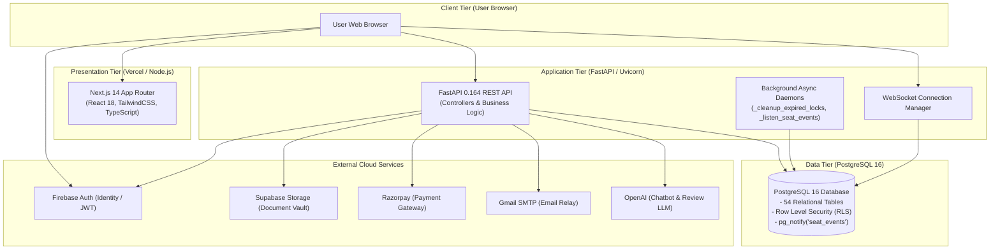
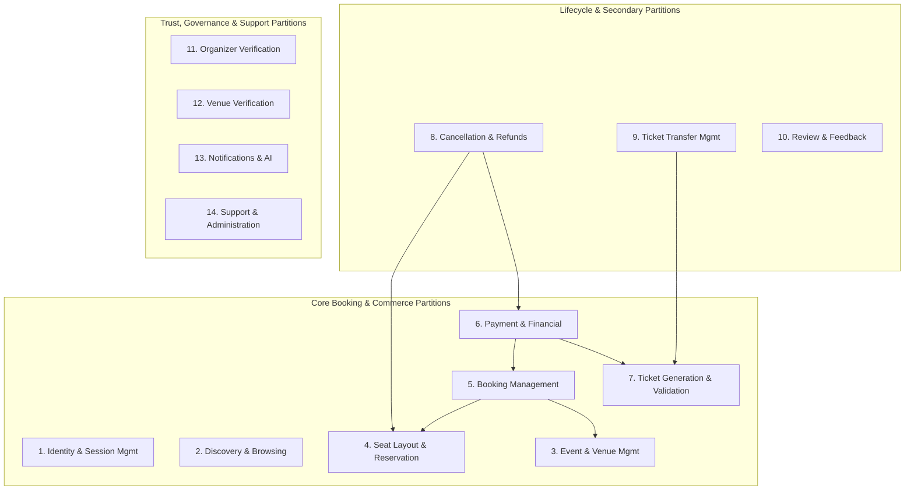
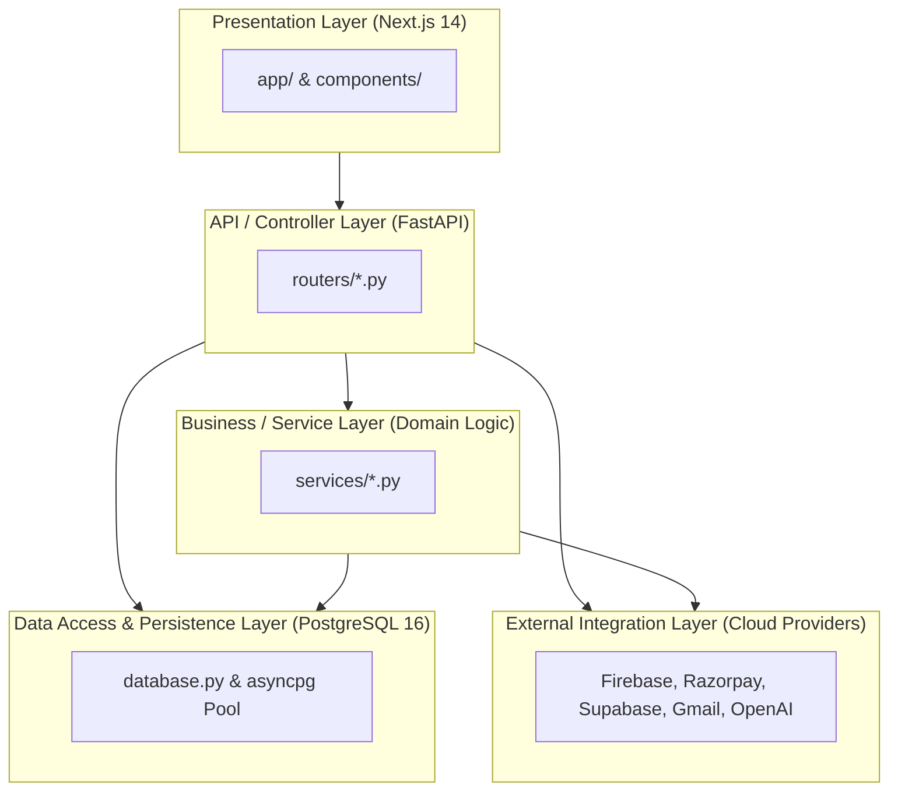

# Object Design Documentation: TicketFlow Platform
**Course:** IT314 Software Engineering  
**Institution:** Dhirubhai Ambani Institute of Information and Communication Technology (DA-IICT)  
**Academic Reference:** Prof. Saurabh Tiwari (Lecture Modules: System Designing, Object Design, Classes and Relationships, Sequence Diagrams, UML State Diagrams, Activity Diagrams)  
**Project:** TicketFlow — Distributed Show Ticket Booking & Event Management System  
**Document Version:** 1.0.0 (Release v0.3.0)  

---

## Table of Contents
1. [Title and Project Information](#1-title-and-project-information)
2. [Purpose, Scope, and Academic Methodology](#2-purpose-scope-and-academic-methodology)
3. [System Architecture Overview](#3-system-architecture-overview)
4. [Subsystem Decomposition and Services](#4-subsystem-decomposition-and-services)
5. [Layering and Partitioning Structure](#5-layering-and-partitioning-structure)
6. [Package Design](#6-package-design)
7. [Component Design and Deployment Wiring](#7-component-design-and-deployment-wiring)
8. [Class and Object Design](#8-class-and-object-design)
9. [Dynamic Object Interactions: Sequence Diagrams](#9-dynamic-object-interactions-sequence-diagrams)
10. [Lifecycle Modeling: State Machine Diagrams](#10-lifecycle-modeling-state-machine-diagrams)
11. [Workflow Control: Activity Diagrams](#11-workflow-control-activity-diagrams)
12. [Design Patterns Catalog](#12-design-patterns-catalog)
13. [Design Decisions, Trade-Offs, and Mismatch Analysis](#13-design-decisions-trade-offs-and-mismatch-analysis)
14. [Source Traceability Matrix](#14-source-traceability-matrix)
15. [Limitations and Team Confirmation Items](#15-limitations-and-team-confirmation-items)
16. [Conclusion](#16-conclusion)

---

## 1. Title and Project Information
TicketFlow is an enterprise-grade ticket booking and event management platform developed by a ten-member software engineering team for IT314 Software Engineering at DA-IICT. Developed across iterative sprints (`v0.1.0` Sprint 1, `v0.2.0` Sprint 2, `v0.3.0` Sprint 3), the platform facilitates end-to-end event discovery, high-concurrency seat reservation, multi-venue custom stage layouts, secure payment processing, verifiable QR ticket generation, peer-to-peer ticket transfers, booking cancellations with automated refunds, and KYC/AML organizer and physical venue verifications.

---

## 2. Purpose, Scope, and Academic Methodology

### 2.1 Purpose
This document provides a complete reverse-engineered object design specification of the existing, deployed TicketFlow application. As an academic software engineering deliverable, it formalizes the system's structural decomposition, component boundaries, persistent object models, dynamic collaborations, state transitions, and business process workflows.

### 2.2 Academic Reference Framework
The models and terminology in this document strictly adhere to the unified modeling language (UML 2.0) conventions and object-oriented software engineering principles taught in the IT314 curriculum:
- **System Designing (L24):** Subsystem decomposition, services, well-defined small subsystem interfaces (APIs), high cohesion, low coupling, partitions vs. layers, open (transparent) vs. closed (opaque) layering, and software architectural styles.
- **Object Design (L25):** Solution domain objects vs. application domain objects, package diagrams for code comprehension, and component diagrams showing provided `( )` and required `) ` interfaces wired towards deployment.
- **Classes and their Relationships (L18):** Object classification, attribute/operation visibility (`+`, `#`, `-`), association, multiplicity intervals (`1`, `1..*`, `0..1`, `*`), aggregation (shared part-whole, white diamond $\diamond$), composition (coincident lifetime, unshared ownership, black diamond $\blacklozenge$), generalization/inheritance (open triangle $\triangle$), and dependency (dashed arrow).
- **Sequence Diagrams (L22):** Use-case realizations, lifelines, synchronous vs. asynchronous messages, activations, creation/destruction, and interaction frames (`alt`, `opt`, `loop`, `critical`, `par`).
- **UML State Diagrams (L23):** Single-entity lifecycles, initial and final pseudo-states, transition labels formatted as `Event [Guard] / Action`, and state action compartments (`entry/`, `exit/`, `do/`).
- **Activity Diagrams (L13):** Dynamic business workflows, control flows, swimlane partitions, initial/final nodes, decision diamonds vs. merge diamonds, and fork/join synchronization bars.

### 2.3 Reverse-Engineering Constraints
In accordance with software engineering reverse-engineering standards:
- **Zero Hallucination:** No imaginary classes or endpoints are fabricated. When functionality is function-based (as is common in FastAPI), it is documented as a module/component rather than converted into a fictional class.
- **Implementation Fidelity:** Persistent entities are mapped directly from the 54 PostgreSQL tables in `database/schema.sql` and migrations `0001` through `0037`. All state enumerations reflect exact database `ENUM` types and `CHECK` constraints.

---

## 3. System Architecture Overview

### 3.1 Architectural Style
TicketFlow employs a distributed **Four-Tier Client-Server Architecture** augmented with a **Publish-Subscribe (Pub/Sub) Bus** for real-time synchronization:
1. **Client Tier:** Web browsers running single-page application client bundles.
2. **Presentation Tier:** Next.js 14 App Router (Node.js runtime) providing server-side rendering, routing, and client hydration.
3. **Application Tier:** FastAPI 0.164 (Python 3.12, Uvicorn ASGI server) providing stateless REST APIs, WebSocket connection management, and background reconciliation daemons.
4. **Data Tier:** PostgreSQL 16 relational database with raw `asyncpg` connection pooling and built-in `LISTEN/NOTIFY` pub/sub messaging.
5. **External Cloud Service Integrations:** Firebase Authentication, Razorpay Gateway, Supabase Storage, Gmail SMTP, and OpenAI API.

*Full architectural breakdown and interfaces documented in [diagrams/architecture.md](diagrams/architecture.md).*

---

## 4. Subsystem Decomposition and Services

### 4.1 Subsystem Inventory
TicketFlow is decomposed into 14 distinct functional subsystems. Each subsystem encapsulates interrelated operations, exhibits high internal cohesion, and exposes a minimal, well-defined service interface:

### 4.2 Subsystem Summary Table
| Subsystem | Scope & Purpose | Main Modules | Exposed Services / Interfaces |
|---|---|---|---|
| **1. Identity & Session** | User registration, role mapping, session inactivity enforcement | `auth.py`, `admin_users.py`, `session_service.py` | `/api/auth/*`, `/api/admin/users/*` |
| **2. Discovery & Browsing** | Show search, geo-distance filtering, city discovery, wishlisting | `browse.py`, `geo_service.py`, `wishlist.py` | `/api/browse/*`, `/api/wishlist/*` |
| **3. Event & Venue Mgmt** | Venue screens, layout configurations, show scheduling | `manager.py`, `event_images.py` | `/api/manager/*` |
| **4. Seat Layout & Reservation** | Real-time seat locking, dynamic multipliers, WebSocket broadcast | `seats.py`, `dynamic_pricing.py` | `/api/seats/*`, `/api/seats/{id}/ws` |
| **5. Booking Management** | Cart checkout, booking number generation, coupon application | `bookings.py`, `terms_service.py` | `/api/bookings/*` |
| **6. Payment & Financial** | Razorpay order generation, HMAC verification, payment receipts | `payments.py` | `/api/payments/*` |
| **7. Ticket Generation & Validation** | ReportLab PDF tickets, signed QR code generation, gate scanning | `tickets.py`, `ticket_service.py`, `qr_service.py` | `/api/tickets/*` |
| **8. Cancellation & Refunds** | Policy evaluation, deduction fee calculation, gateway refunds | `cancellations.py`, `refund_service.py` | `/api/cancellations/*` |
| **9. Ticket Transfer Mgmt** | Peer-to-peer ticket splitting, email invites, claim verification | `ticket_transfers.py`, `ticket_transfer.py` | `/api/transfers/*` |
| **10. Review & Feedback** | Customer & critic reviews, version audit trail, AI sentiment summaries | `reviews.py`, `ai_review_summary_service.py` | `/api/reviews/*` |
| **11. Organizer Verification** | KYC/AML verification, SHA-256 duplicate detection, risk scoring | `organizer_verification.py`, `verification.py` | `/api/verification/*` |
| **12. Venue Verification** | Physical venue safety compliance, fire certificate verification | `venue_verification.py`, `venue_review.py` | `/api/venue-verification/*` |
| **13. Notifications & AI** | System alerts, Gmail SMTP delivery, OpenAI conversational assistant | `notifications.py`, `email_service.py`, `chat.py` | `/api/notifications/*`, `/api/chat/*` |
| **14. Support & Administration** | Customer ticketing, manager analytics, system audit logging | `support.py`, `support_admin.py`, `manager_analytics.py` | `/api/support/*`, `/api/manager/analytics/*` |

*Detailed subsystem service descriptions and dependencies available in [diagrams/subsystem-decomposition.md](diagrams/subsystem-decomposition.md).*

---

## 5. Layering and Partitioning Structure

### 5.1 Layering Model
Following the definitions in Lecture 24 (System Designing):
- **Partitions (Horizontal):** Divide the system into weakly coupled subsystems operating on the same level of abstraction (e.g., Booking Management and Review Management are peer partitions).
- **Layers (Vertical):** Hierarchical ordering where higher layers provide abstraction and depend on services from lower layers:
  1. **Presentation Layer:** Next.js React UI components, page layouts, client state.
  2. **API / Controller Layer:** FastAPI routers validating HTTP inputs, UUID path parameters, and authentication tokens.
  3. **Business / Service Layer:** Domain logic functions (`dynamic_pricing.py`, `ticket_transfer.py`, `risk_assessment.py`).
  4. **Data Access / Persistence Layer:** PostgreSQL 16 database connection pool (`asyncpg`).
  5. **External Integration Layer:** Third-party cloud REST/SMTP APIs.

### 5.2 Open (Transparent) Layering Analysis
In Lecture 24, a **closed architecture (opaque layering)** requires any layer to invoke operations only from the immediate layer below it. An **open architecture (transparent layering)** permits a layer to invoke operations from any layer below it.

**Architectural Finding:** TicketFlow implements an **Open Layering** architecture:
- FastAPI router controllers frequently bypass `services/` and directly execute parameterised asyncpg SQL on `database.py` connection objects (`conn.fetch`, `conn.execute`), e.g., in `browse.py`, `bookings.py`, and `manager.py`.
- Complex multi-step operations (ticket transfers, KYC risk scoring, payment refunds) route through dedicated `services/` modules.
- **Trade-Off:** This open layering strategy was intentionally chosen by the team for runtime efficiency and rapid development, eliminating redundant repository boilerplate while maintaining strong parameterized SQL security ($1, $2).

---

## 6. Package Design

### 6.1 Backend Package Organization
The backend repository is organized into distinct packages:
- `backend/routers`: HTTP route controllers declaring REST/WebSocket endpoints.
- `backend/services`: Domain business rules, calculation algorithms, and third-party API adapters.
- `backend/models`: Pydantic domain models (e.g., verification risk assessment structures).
- `backend/schemas`: API request/response validation schemas.
- `backend/` (root): Infrastructure modules (`main.py`, `config.py`, `database.py`, `dependencies.py`, `path_ids.py`).

*Full diagram and dependency breakdown in [diagrams/backend-packages.md](diagrams/backend-packages.md).*

### 6.2 Frontend Package Organization
The Next.js 14 frontend follows the standard App Router structure:
- `frontend/app`: File-system routes partitioned by user role (`/shows`, `/bookings`, `/manager`, `/admin`, `/auth`).
- `frontend/components`: Reusable view widgets (`VenueLayoutCanvas.tsx`, `TransferTicketsPanel.tsx`, modals).
- `frontend/contexts`: Global React state providers (`AuthContext.tsx`, `LocationContext.tsx`).
- `frontend/lib`: Strongly typed API client wrappers (`api.ts`, `transfersApi.ts`, `cancellationsApi.ts`).

*Full frontend package diagram and coupling analysis in [diagrams/frontend-packages.md](diagrams/frontend-packages.md).*

---

## 7. Component Design and Deployment Wiring

The component diagram visualizes deployable units wired through provided and required interfaces:
- **`NextJS_SPA`:** Requires `I_RestAPI` and `I_WebSocket` provided by the backend, and `I_FirebaseAuth` provided by Firebase.
- **`FastAPI_App`:** Provides `I_RestAPI`, requires `I_PostgreSQL` (connection pool), `I_PgNotify` (cross-instance pub/sub), `I_Payment` (Razorpay), `I_Storage` (Supabase), and `I_MailRelay` (Gmail SMTP).
- **`WebSocket_Hub`:** Provides `I_WebSocket` and synchronizes cross-instance state via PostgreSQL's `seat_events` notification channel.

*Full UML Component Diagram and detailed Booking & Payment subsystem view in [diagrams/component-diagram.md](diagrams/component-diagram.md).*

---

## 8. Class and Object Design

Persistent domain entities are derived directly from the PostgreSQL relational schema and Pydantic validation structures. Below are the class diagrams for each major functional domain:

### 8.1 Users, Roles, and Sessions
Models `User`, `Role`, `UserRole`, `UserSession`, `OrganizerProfile`, and `BankAccount`.
- **Composition:** `User *-- UserSession` (deleting user cascades to purge active sessions).
- **Aggregation:** `User o-- OrganizerProfile` (user exists independently of organizer KYC).
- Detailed diagram and attributes: [diagrams/class-users.md](diagrams/class-users.md).

### 8.2 Events, Shows, Venues, and Seats
Models `Venue`, `Screen`, `Seat`, `Event`, `Show`, `ShowSeat`, and `ShowZone`.
- **Physical vs. Scheduled Distinction:** `Seat` represents physical auditorium geometry (`screen_id`, `row_label`, `seat_number`), whereas `ShowSeat` represents an individual show's transactional seat instance with `status`, `price`, `locked_price`, `locked_until`, and `locked_by`.
- **Composition:** `Venue *-- Screen`, `Screen *-- Seat`, `Show *-- ShowZone`.
- Detailed diagram and attributes: [diagrams/class-events-venues.md](diagrams/class-events-venues.md).

### 8.3 Bookings, Payments, and Checkout
Models `Booking`, `BookingSeat`, `BookingZone`, `Coupon`, `PaymentOrder`, `Payment`, `Receipt`, and `CancellationPolicy`.
- **Composition:** `Booking *-- BookingSeat`, `Booking *-- PaymentOrder`, `Payment *-- Receipt`.
- **Aggregation:** `Booking o-- Coupon` (coupons exist independently in manager catalogues).
- Detailed diagram and attributes: [diagrams/class-booking-payment.md](diagrams/class-booking-payment.md).

### 8.4 Tickets and Peer-to-Peer Transfers
Models `Ticket`, `TicketTransfer`, `TicketTransferSeat`, `TicketTransferZone`, `TransferDemoPayment`, and `TransferMessageDelivery`.
- **Composition:** `TicketTransfer *-- TicketTransferSeat`, `TicketTransfer *-- TransferMessageDelivery`.
- **Self-Association:** `TicketTransfer` supports hierarchical forwarding chains via `parent_transfer_id`.
- Detailed diagram and attributes: [diagrams/class-tickets-transfers.md](diagrams/class-tickets-transfers.md).

### 8.5 Reviews and AI Sentiment Analysis
Models `Review`, `ReviewComment`, `ReviewUpvote`, `ReviewVersion`, `ReviewReport`, and `AiReviewSummary`.
- **Composition:** `Review *-- ReviewVersion` (immutable audit snapshot on edit), `Review *-- ReviewComment`.
- Detailed diagram and attributes: [diagrams/class-reviews.md](diagrams/class-reviews.md).

### 8.6 Organizer and Venue Verification
Models `VerificationCase`, `VerificationDocument`, `DuplicateFingerprint`, `VenueVerificationCase`, `VenueCaseDocument`, and `VenueVerificationAudit`.
- **Composition:** `VerificationCase *-- VerificationDocument`, `VenueVerificationCase *-- VenueVerificationAudit`.
- Detailed diagram and attributes: [diagrams/class-verification.md](diagrams/class-verification.md).

### 8.7 Notifications, Support, and Administration
Models `Notification`, `SupportRequest`, `SupportMessage`, `AdminAuditLog`, `AuditLog`, and `TermsAcceptance`.
- **Composition:** `SupportRequest *-- SupportMessage`.
- Detailed diagram and attributes: [diagrams/class-support-admin.md](diagrams/class-support-admin.md).

---

## 9. Dynamic Object Interactions: Sequence Diagrams

The dynamic behavior of the system is modeled through scenario-based sequence diagrams utilizing standard UML activation boxes and interaction frames (`alt`, `opt`, `loop`, `par`):

1. **Customer Seat Selection & Booking:** End-to-end flow from seat map loading, non-optimistic seat locking, checkout, Razorpay order creation, HMAC verification, ticket issuance, and email delivery.  
   $\rightarrow$ Full diagram: [diagrams/sequence-booking.md](diagrams/sequence-booking.md)
2. **Seat-Lock Concurrency & Arbitration:** Race condition resolution when User A and User B concurrently attempt to lock the same seat. Details atomic SQL execution, partial lock rollback, HTTP 409 conflict return, and real-time WebSocket sync via `pg_notify`.  
   $\rightarrow$ Full diagram: [diagrams/sequence-seat-locking.md](diagrams/sequence-seat-locking.md)
3. **Booking Cancellation & Refund:** Policy evaluation against show start time, fee deduction calculation, Razorpay refund API dispatch, transactional seat inventory recovery, and failure handling.  
   $\rightarrow$ Full diagram: [diagrams/sequence-cancellation-refund.md](diagrams/sequence-cancellation-refund.md)
4. **Peer-to-Peer Ticket Transfer:** Transfer initiation, email invitation dispatch, token claim link verification, recipient acceptance, old QR code invalidation, and new ticket reissuance.  
   $\rightarrow$ Full diagram: [diagrams/sequence-ticket-transfer.md](diagrams/sequence-ticket-transfer.md)
5. **Organizer Verification (KYC/AML):** Document upload to Supabase vault, automated SHA-256 duplicate detection, composite risk assessment scoring, admin review queue claim, and payout activation.  
   $\rightarrow$ Full diagram: [diagrams/sequence-organizer-verification.md](diagrams/sequence-organizer-verification.md)
6. **Venue Verification:** Draft configuration, fire safety certificate upload, admin claim, compliance decision, and immutable audit logging.  
   $\rightarrow$ Full diagram: [diagrams/sequence-venue-verification.md](diagrams/sequence-venue-verification.md)
7. **Review Submission & AI Summarization:** Review submission, version snapshotting on edit, and asynchronous LLM sentiment extraction via OpenAI API.  
   $\rightarrow$ Full diagram: [diagrams/sequence-review.md](diagrams/sequence-review.md)
8. **User Authentication & Session Inactivity:** Firebase ID token exchange, server-side session issuance, per-request `X-Session-ID` validation, and role-based inactivity timeout enforcement.  
   $\rightarrow$ Full diagram: [diagrams/sequence-authentication.md](diagrams/sequence-authentication.md)

---

## 10. Lifecycle Modeling: State Machine Diagrams

Entity lifecycles with interesting dynamic behavior are modeled using UML 2.0 state machine diagrams:

1. **Booking Lifecycle:** States `pending` $\rightarrow$ `confirmed` | `cancelled` | `expired`. Governed by payment verification and cancellation cutoff rules.  
   $\rightarrow$ Details: [diagrams/state-booking.md](diagrams/state-booking.md)
2. **Show Seat Lifecycle:** States `available` $\leftrightarrow$ `locked` $\rightarrow$ `booked` (or `reserved`). Governed by 10-minute hold timers and atomic queries.  
   $\rightarrow$ Details: [diagrams/state-seat.md](diagrams/state-seat.md)
3. **Payment Lifecycle:** States `created` $\rightarrow$ `pending` $\rightarrow$ `successful` | `failed` $\rightarrow$ `refunded`.  
   $\rightarrow$ Details: [diagrams/state-payment.md](diagrams/state-payment.md)
4. **Ticket Lifecycle:** States `valid` $\rightarrow$ `used` | `cancelled`. QR code invalidation on scanning, cancellation, or transfer.  
   $\rightarrow$ Details: [diagrams/state-ticket.md](diagrams/state-ticket.md)
5. **Ticket Transfer Lifecycle:** States `pending` $\rightarrow$ `accepted` | `declined` | `cancelled` | `expired`.  
   $\rightarrow$ Details: [diagrams/state-ticket-transfer.md](diagrams/state-ticket-transfer.md)
6. **Organizer Verification Lifecycle:** States `DRAFT` $\rightarrow$ `SUBMITTED` $\rightarrow$ `IN_REVIEW` $\rightarrow$ `CHANGES_REQUESTED` | `APPROVED` | `REJECTED` | `SUSPENDED` | `EXPIRED`.  
   $\rightarrow$ Details: [diagrams/state-organizer-verification.md](diagrams/state-organizer-verification.md)
7. **Venue Verification Lifecycle:** States `draft` $\rightarrow$ `submitted` $\rightarrow$ `in_review` $\rightarrow$ `changes_requested` | `approved` | `rejected` | `expired`.  
   $\rightarrow$ Details: [diagrams/state-venue-verification.md](diagrams/state-venue-verification.md)
8. **Refund Lifecycle:** States `PENDING` $\rightarrow$ `PROCESSING` $\rightarrow$ `PROCESSED` | `FAILED`. Supports admin retries on gateway failures.  
   $\rightarrow$ Details: [diagrams/state-refund.md](diagrams/state-refund.md)

---

## 11. Workflow Control: Activity Diagrams

Activity diagrams model end-to-end multi-swimlane business workflows:

1. **End-to-End Customer Booking Workflow:** Six swimlanes (*Customer*, *Next.js Frontend*, *FastAPI Backend*, *PostgreSQL Database*, *Razorpay Gateway*, *Ticket & Notification Service*). Details seat selection, atomic lock acquisition, cart checkout, payment authorization, parallel ticket rendering/emailing, and error fallbacks.  
   $\rightarrow$ Full diagram: [diagrams/activity-customer-booking.md](diagrams/activity-customer-booking.md)
2. **Booking Cancellation & Refund Workflow:** Swimlanes tracing customer eligibility checks, policy evaluation, transactional seat inventory recovery, gateway refund calls, and customer alerts.  
   $\rightarrow$ Full diagram: [diagrams/activity-cancellation.md](diagrams/activity-cancellation.md)

---

## 12. Design Patterns Catalog

Below is a catalog of design patterns visibly present in the TicketFlow codebase, with source evidence and rationale:

| Pattern | Category | Implementation Location | Evidence in Source Code | Design Rationale |
|---|---|---|---|---|
| **Dependency Injection** | Structural | `backend/dependencies.py` | `Depends(get_current_user)`, `Depends(get_conn)` | Decouples route handlers from authentication and connection pooling; facilitates unit testing with `AsyncMock`. |
| **Strategy Pattern** | Behavioral | `backend/services/dynamic_pricing.py` | `compute_multiplier(start_time, sold_seats, ...)` | Allows interchangeable pricing algorithms (demand surge, early bird, off-peak) based on show and event parameters. |
| **Observer / Pub-Sub** | Behavioral | `backend/routers/seats.py` & `main.py` | `SELECT pg_notify('seat_events', ...)` & `conn.add_listener('seat_events')` | Broadcasts real-time seat locks and releases across horizontally scaled backend instances without requiring Redis. |
| **Adapter Pattern** | Structural | `backend/dependencies.py` | `verify_firebase_token()` $\rightarrow$ `users` row mapping | Adapts external Firebase ID token claims (`sub`, `email`) into internal PostgreSQL user entities and role permissions. |
| **Factory / Creator** | Creational | `backend/services/ticket_service.py` | `generate_tickets_for_booking()` | Encapsulates complex creation of PDF tickets, cryptographically signed QR code tokens, and database records. |
| **Document Vault Pattern** | Security / Storage | `backend/services/document_vault.py` | `store_document()` with SHA-256 and signed URLs | Secures sensitive KYC documents in private cloud buckets, issuing time-limited signed URLs only to authorized admins. |
| **Template Method / Workflow** | Behavioral | `backend/services/ticket_transfer.py` | Multi-step transfer validation, split, and claim pipeline | Enforces invariant transfer rules (ownership validation $\rightarrow$ hold $\rightarrow$ acceptance $\rightarrow$ reissuance) while allowing customization for reimbursement. |

---

## 13. Design Decisions, Trade-Offs, and Mismatch Analysis

### 13.1 Non-Optimistic UI vs. Optimistic Selection
- **Observed Decision:** In `frontend/app/shows/[showId]/seats/page.tsx`, the UI was redesigned to be strictly non-optimistic. When a customer clicks a seat, it enters a `pending` state (amber pulse). It is added to `selectedSeatIds` only after the backend confirms `200 OK`.
- **Trade-Off:** Adds round-trip latency (~50–150ms) to the user click feedback, but completely eliminates desynchronization, phantom selections, and "Seat not locked by you" checkout crashes in high-concurrency environments.

### 13.2 Open Layering vs. Strict Repository Encapsulation
- **Observed Decision:** Direct SQL queries in router handlers rather than a mandatory repository class per entity.
- **Trade-Off:** Trades strict architectural encapsulation for execution performance, concise code, and full utilization of PostgreSQL features (JSON aggregation, conditional `RETURNING`, `FILTER (WHERE ...)`).

### 13.3 Asynchronous Cancellation Decoupling
- **Observed Decision:** Seat inventory is restored to `available` immediately in the cancellation transaction, before the external Razorpay refund API call completes.
- **Trade-Off:** If Razorpay experiences an outage, seats are already freed for new buyers. The refund record is marked `FAILED` for admin retry, prioritizing venue ticket sales over banking synchronization delays.

---

## 14. Source Traceability Matrix

| Design Element | Primary Source Files | Implementation Evidence | Confidence |
|---|---|---|---|
| User & Role Management | `backend/routers/auth.py`, `dependencies.py` | `users`, `roles`, `user_roles` queries; token verification | **Verified** |
| Session Inactivity Enforcement | `backend/services/session_service.py` | `user_sessions` table, `X-Session-ID` header validation | **Verified** |
| Event, Venue & Screen Layout | `backend/routers/manager.py`, `browse.py` | `venues`, `screens`, `events`, `shows` tables; custom layout engine | **Verified** |
| Real-Time Seat Concurrency | `backend/routers/seats.py`, `main.py` | Atomic `UPDATE show_seats`, `pg_notify('seat_events')`, WebSocket hub | **Verified** |
| Dynamic Seat Pricing | `backend/services/dynamic_pricing.py` | Demand, early-bird, and peak multipliers applied to `locked_price` | **Verified** |
| Booking & Checkout Flow | `backend/routers/bookings.py` | Cart checkout, subtotal, discount, terms acceptance recording | **Verified** |
| Razorpay Payment Gateway | `backend/routers/payments.py` | Order creation, HMAC SHA-256 signature verification | **Verified** |
| Ticket PDF & QR Issuance | `backend/services/ticket_service.py` | ReportLab flowables, `qrcode` library generation | **Verified** |
| Booking Cancellation & Refund | `backend/routers/cancellations.py`, `refund_service.py` | Policy evaluation, Razorpay refund API call, transactional seat release | **Verified** |
| Peer-to-Peer Ticket Transfers | `backend/services/ticket_transfer.py` | Migration 0031–0037 tables, invitation tokens, QR reissuance | **Verified** |
| Review & AI Sentiment Summaries | `backend/routers/reviews.py`, `ai_review_summary_service.py` | `reviews`, `review_versions`, OpenAI completion calls | **Verified** |
| Organizer Verification (KYC) | `backend/routers/organizer_verification.py` | `verification_cases`, SHA-256 duplicate detection, risk scoring | **Verified** |
| Venue Verification Compliance | `backend/routers/venue_verification.py` | `venue_verification_cases`, `venue_verification_audit` | **Verified** |
| AI Chatbot Assistant | `backend/routers/chat.py`, `services/chatbot.py` | OpenAI streaming endpoint, tool-calling integration | **Verified** |

---

## 15. Limitations and Team Confirmation Items

The following architectural observations reflect implementation nuances requiring team consensus during future sprints:
1. **Database-Level Seat Lock Cleanup:** Seat lock expiration is driven by two mechanisms: passive cleanup on `/api/seats/{id}/map` requests and a periodic background task `_cleanup_expired_locks()` running every 2 minutes in `backend/main.py`. While effective, heavy burst traffic may benefit from a dedicated pg_cron extension or Redis TTL in production.
2. **Transfer Reimbursement Gateway Integration:** Ticket transfers support a demo payment flow (`transfer_demo_payments`). Production deployment on Azure should transition this to live Razorpay Route or P2P UPI payment splits.
3. **Open Layering Governance:** As the application expands past 54 tables, defining formal repository interfaces for critical entities (Bookings, Tickets) may enhance unit testability and prevent query duplication across routers.

---

## 16. Conclusion
The TicketFlow platform demonstrates a robust, modern software architecture balancing high throughput with rigorous safety constraints. By employing an open layered structure, stateless API nodes, PostgreSQL-native concurrency primitives (`pg_notify`, atomic conditional updates), and third-party cloud services, the platform fulfills the requirements of a high-concurrency ticket booking system.

This documentation comprehensively reflects the operational reality of the codebase and aligns with the academic software engineering standards established in IT314 at DA-IICT.
